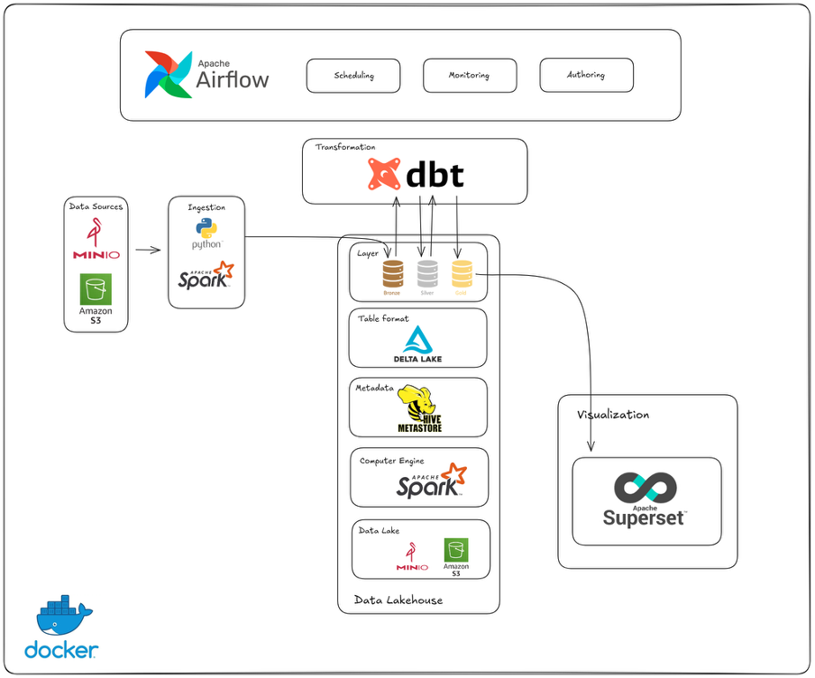

# LakeHouse Architecture For Real Estate Data

## Tổng Quan Dự Án

Hệ thống Lakehouse hoàn chỉnh để thu thập, xử lý và phân tích dữ liệu bất động sản từ Chợ Tốt, sử dụng kiến trúc **Medallion** (Bronze-Silver-Gold).

## Chạy Bronze khi Docker có khoảng 8 GiB RAM

Chạy từ thư mục dự án:

```bash
bash scripts/load_bronze.sh \
  --crawl-date 2026-08-19 \
  --run-id legacy_20260819_100631
```

Thêm `--validate-only` để chỉ đọc, chuẩn hóa và đếm, không ghi Delta/Hive.
Wrapper dùng driver 768 MiB, một executor 512 MiB với một core, và tắt
dynamic allocation. DAG Bronze dùng cùng ngân sách. Đây là mức khởi đầu cho
máy phát triển, không phải bảo đảm mọi kích thước dữ liệu đều chạy được.
Không chạy nhiều job Bronze đồng thời trên cấu hình này.

Compose đặt MLflow mặc định một worker (`MLFLOW_WORKERS=1`) và tắt các tiến
trình chạy job nền (`MLFLOW_SERVER_ENABLE_JOB_EXECUTION=false`) để giảm RAM
nền. Tracking/registry vẫn được phục vụ; tính năng chạy job bất đồng bộ trên
MLflow server sẽ không khả dụng. Nếu cần tính năng này, đặt biến trên thành
`true` và tăng RAM Docker. Xem [cấu hình MLflow](https://mlflow.org/docs/latest/api_reference/python_api/mlflow.environment_variables.html).
Sau khi cập nhật, áp dụng bằng
`docker compose up -d --no-deps mlflow` (MLflow sẽ khởi động lại ngắn hạn).
Có thể tăng `MLFLOW_WORKERS` khi cần phục vụ nhiều yêu cầu đồng thời và có
đủ RAM; không dùng mức bốn worker cùng heap Spark 6 GiB trên Docker 8 GiB.

Script giữ nguyên payload dạng struct cho dbt, deduplicate theo cùng khóa,
đếm tổng/hợp lệ trong một aggregation và tái sử dụng dữ liệu qua `DISK_ONLY`.
Cache được giải phóng kể cả khi job lỗi. Tám shuffle partitions ban đầu,
AQE và batch cache 1.000 dòng giúp hạn chế overhead và áp lực RAM; cấu hình
SQL truyền qua `spark-submit --conf` được ưu tiên hơn mặc định trong script.

Chỉ tăng `BRONZE_DRIVER_MEMORY` hoặc `BRONZE_EXECUTOR_MEMORY` khi Docker còn
RAM trống. Heap JVM không bao gồm toàn bộ bộ nhớ tiến trình; cần chừa RAM cho
MinIO, Hive, Airflow, MLflow và các dịch vụ khác. Nếu vẫn gặp OOM, tăng RAM
Docker hoặc dừng dịch vụ không sử dụng trước khi tăng heap Spark.

Kiểm chứng ngày 2026-09-19: Landing `legacy_20260819_100631` (7.883.491 byte,
985 dòng) chạy qua chuẩn hóa, ghi Delta, đăng ký Hive và MERGE lần hai vào
vùng thử riêng; vẫn 985 dòng, payload giữ nguyên, không tăng bộ đếm OOM trong
lượt kiểm chứng cuối. Vùng thử đã được dọn. MLflow trả HTTP 200 cho health và
tra cứu experiment, dùng khoảng 473 MiB sau khi tắt job nền. Kết quả này chưa
phải benchmark cho các tập dữ liệu lớn hơn hoặc nhiều job đồng thời.

## Kiến Trúc Hệ Thống



## Quy Trình Hoạt Động
```
┌─────────────────────────────────────────────────────────────────┐
│                        DATA SOURCES                              │
│                   Chợ Tốt API (Real Estate)                      │
└────────────────────────┬────────────────────────────────────────┘
                         │
                         ↓
┌─────────────────────────────────────────────────────────────────┐
│                    INGESTION LAYER                               │
│              Airflow DAG (Daily Schedule)                        │
│              - Crawl API (Python)                                │
│              - Save to MinIO (S3)                                │
└────────────────────────┬────────────────────────────────────────┘
                         │
                         ↓
┌─────────────────────────────────────────────────────────────────┐
│                    BRONZE LAYER (Raw Data)                       │
│              Storage: MinIO (S3-compatible)                      │
│              Format: JSON Lines (.jsonl)                         │
│              Location: s3a://lakehouse/bronze/json/              │
│              Spark: Load → Delta Table                           │
└────────────────────────┬────────────────────────────────────────┘
                         │
                         ↓
┌─────────────────────────────────────────────────────────────────┐
│                  SILVER LAYER (Clean Data)                       │
│              Tool: dbt + Spark Thrift Server                     │
│              Model: stg_properties                               │
│              - Deduplication (keep latest)                       │
│              - Parse numbers from text                           │
│              - Normalize address                                 │
│              - Data quality flag                                 │
│              Format: Delta Table                                 │
└────────────────────────┬────────────────────────────────────────┘
                         │
                         ↓
┌─────────────────────────────────────────────────────────────────┐
│                   GOLD LAYER (Analytics)                         │
│              Tool: dbt Models                                    │
│              Tables:                                             │
│              - fct_properties (fact table)                       │
│              - fct_daily_summary (aggregated)                    │
│              - fct_data_quality_report (monitoring)              │
│              Format: Delta Table                                 │
└────────────────────────┬────────────────────────────────────────┘
                         │
                         ↓
┌─────────────────────────────────────────────────────────────────┐
│                   VISUALIZATION                                  │
│              Apache Superset (Connect via Spark Thrift)          │
│              - Dashboards                                        │
│              - Ad-hoc queries                                    │
└─────────────────────────────────────────────────────────────────┘
```

## Tech Stack

| Component          | Technology     | Purpose                        |
| ------------------ | -------------- | ------------------------------ |
| **Orchestration**  | Apache Airflow | Schedule & monitor pipelines   |
| **Storage**        | MinIO (S3)     | Object storage for data lake   |
| **Processing**     | Apache Spark   | Distributed data processing    |
| **Catalog**        | Hive Metastore | Metadata management            |
| **Transformation** | dbt            | SQL-based transformations      |
| **Format**         | Delta Lake     | ACID transactions, time travel |
| **Visualization**  | Apache Superset| BI dashboards                  |
| **Container**      | Docker Compose | Infrastructure as code         |

## Cấu Trúc Dự Án

```
.
├── airflow/                    # Airflow configuration
│   ├── dags/
│   │   └── end_to_end_pipeline.py  # Main ELT pipeline
│   ├── jars/                   # Spark dependencies
│   └── config/
├── dbt/                        # dbt project
│   ├── models/
│   │   ├── staging/            # Silver layer
│   │   │   └── stg_properties.sql
│   │   └── marts/              # Gold layer
│   │       ├── fct_properties.sql
│   │       ├── fct_daily_summary.sql
│   │       └── fct_data_quality_report.sql
│   └── DATA_QUALITY_GUIDE.md
├── spark/                      # Spark configuration
├── scripts/                    # Utility scripts
│   └── load_bronze_to_table.py
├── hive-metastore/            # Metastore config
└── docker-compose.yml         # Infrastructure definition
```

## Khởi Động Hệ Thống

### 1. Start Services

```bash
docker-compose up -d
```

### 2. Kiểm Tra Services

```bash
# Airflow
http://localhost:8088

# Spark Master
http://localhost:8081

# MinIO Console
http://localhost:9001

# Apache Superset
http://localhost:8089
```

### 3. Chạy Pipeline

```bash
# Create connection
docker exec airflow-scheduler airflow connections add 'spark_default' \
    --conn-type 'spark' \
    --conn-host 'spark://spark-master' \
    --conn-port '7077' \
    --conn-extra '{"deploy-mode": "client"}' 2>&1 | tail -5

# Trigger DAG manually
docker exec airflow-webserver airflow dags trigger end_to_end_lakehouse_pipeline

# Hoặc đợi schedule (daily)
```

## Data Flow

### 1. **Bronze Layer** (Raw Ingestion)

- **Input**: Chợ Tốt API responses
- **Process**: Crawl → Save to MinIO as JSONL
- **Output**: `s3a://lakehouse/bronze/json/crawl_*.jsonl`
- **Table**: `bronze.raw_properties`

### 2. **Silver Layer** (Data Cleaning)

- **Input**: `bronze.raw_properties`
- **Process**:
  - Deduplication (latest record per property_id)
  - Parse numbers from Vietnamese text
  - Normalize price (convert to billions VNĐ)
  - Normalize address (proper case)
  - Add data quality flags
- **Output**: `silver.stg_properties`
- **Key Improvements**:

### 3. **Gold Layer** (Analytics Ready)

- **Input**: `silver.stg_properties`
- **Process**:
  - Filter only VALID records
  - Remove outliers
  - Calculate metrics (price per m²)
  - Aggregate summaries
- **Output**:
  - `gold.fct_properties` - Main fact table
  - `gold.fct_daily_summary` - Daily aggregations
  - `gold.fct_data_quality_report` - Quality monitoring

## Visualization Layer - Apache Superset

### Superset Connection Options

**Spark Thrift Server**

```yaml
Connection Type: Apache Hive
SQLAlchemy URI: hive://spark-thrift-server:10000?auth=NOSASL
```

### Quick Start with Superset

```bash
# 1. Start Superset
docker-compose up -d superset

# 2. Create admin user
docker exec -it superset bash
superset fab create-admin \
    --username admin \
    --firstname Admin \
    --lastname User \
    --email admin@superset.com \
    --password admin
exit

3. Access UI
Open: http://localhost:8089
Login: admin / admin

4. Add Hive database connection
Settings > Database Connections > + Database
Type: Apache Hive
URI: hive://spark-thrift-server:10000?auth=NOSASL

```

## Contributors

Data Engineering Team

## License

MIT License

---

**Last Updated:** November 21, 2025
**Version:** 2.0
