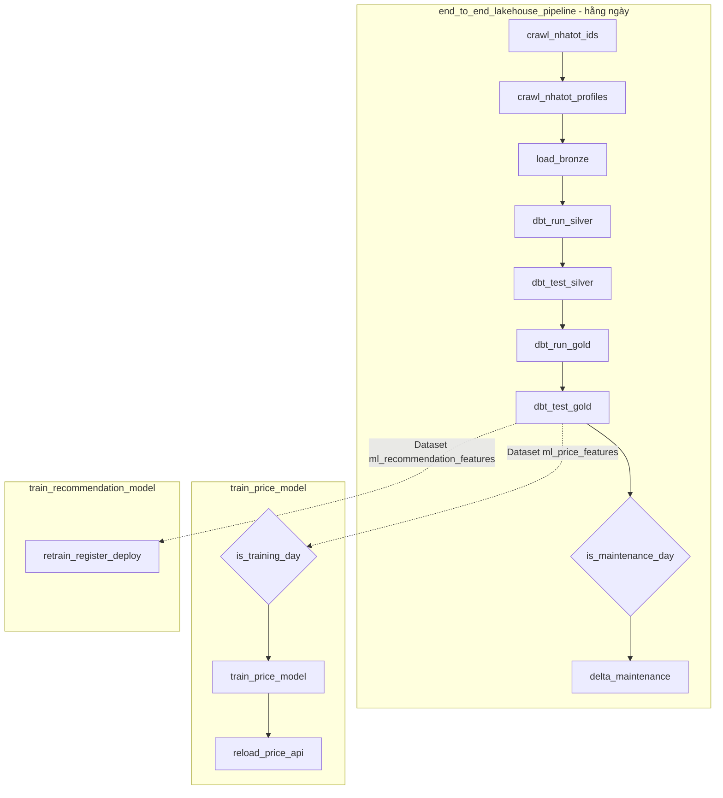

# Airflow: các DAG và nhiệm vụ của từng task

Tài liệu này mô tả 3 DAG của dự án: mỗi task làm gì, đọc và ghi vào đâu, chạy ở container nào, khi lỗi thì xử lý ra sao. Nội dung lấy từ code ngày 05/11/2026. Kiến trúc dữ liệu chi tiết từng tầng xem [ARCHITECTURE.md](ARCHITECTURE.md), còn phần MLflow và API xem [MLFLOW_VA_FASTAPI.md](MLFLOW_VA_FASTAPI.md).

Airflow UI: http://localhost:8088 (tài khoản `admin` / `admin`).

## 1. Tổng quan

| DAG | File (trong `airflow/dags/`) | Lịch chạy | Việc chính |
|---|---|---|---|
| `end_to_end_lakehouse_pipeline` | `end_to_end_pipeline.py` | Hằng ngày (`@daily`, giờ Việt Nam) | Crawl Nhà Tốt → Bronze → Silver → Gold, kiểm tra chất lượng, bảo trì Delta |
| `train_price_model` | `end_to_end_pipeline.py` | Khi Gold đạt test, nhưng chỉ train vào **thứ Hai** | Train model giá, quality gate, nạp lại API giá |
| `train_recommendation_model` | `train_recommendation_model.py` | Mỗi lần Gold đạt test | Train model gợi ý, kiểm tra kỹ thuật, nạp lại API gợi ý |



Hai DAG train không có giờ chạy cố định. Chúng được kích hoạt bằng **Dataset**: khi task `dbt_test_gold` thành công, Airflow ghi nhận hai Dataset `lakehouse://gold/ml_price_features` và `lakehouse://gold/ml_recommendation_features` vừa được cập nhật, rồi tự chạy hai DAG train. Gold không đạt test thì không DAG train nào chạy, nên model không bao giờ học từ dữ liệu lỗi.

## 2. Cấu hình chung

| Cấu hình | Giá trị | Ý nghĩa |
|---|---|---|
| `max_active_runs` | 1 cho cả 3 DAG | Không có hai lần chạy của cùng một DAG chồng lên nhau |
| `catchup` | `False` | Bật lại sau nhiều ngày tắt thì không chạy bù các ngày đã lỡ |
| `retries` | 1 lần, cách 5 phút (task train gợi ý: 1 lần, cách 2 phút) | Lỗi mạng hoặc lỗi tạm thời được thử lại một lần |
| Executor | `LocalExecutor` trong container `airflow-scheduler` | Mọi task chạy trong container này, giới hạn 3 GB RAM |
| Pool `ml_training` | 1 slot | Hai task train dùng chung, nên chạy lần lượt (mục 6) |

`run_id` và `crawl_date` được tính từ ngày logic của DAG run theo giờ Việt Nam, ví dụ `20261105_000000` và `2026-11-05`. Hai giá trị này cố định cho một DAG run, nên khi một task chạy lại, nó ghi đè đúng thư mục của chính nó thay vì tạo dữ liệu mới. Nhờ vậy chạy lại một task là an toàn.

Các task Spark chạy ở chế độ client: driver nằm trong `airflow-scheduler`, executor nằm trên `spark-worker-1` và `spark-worker-2`. Cluster có 4 core. Crawler lấy tối đa 3 core, 1 core còn lại để Spark Thrift Server phục vụ Superset và dbt.

## 3. DAG `end_to_end_lakehouse_pipeline`

Các task chạy nối tiếp nhau. Một task lỗi (sau khi đã retry) thì các task phía sau không chạy.

### 3.1 `crawl_nhatot_ids`

| Mục | Chi tiết |
|---|---|
| Nhiệm vụ | Lấy danh sách mã tin đang đăng trên Nhà Tốt ở TP.HCM |
| Loại task | Spark job (`scripts/crawl_nhatot_ids.py`), tối đa 3 core |
| Đọc | API danh sách `gateway.chotot.com/v1/public/ad-listing` |
| Ghi | `s3a://lakehouse/landing/source=nhatot_ids/crawl_date=…/run_id=…/` và một file audit đếm số tin bán, tin thuê |
| Thời gian | Khoảng 10 phút |

Mỗi phạm vi crawl là một cặp (quận, loại tin): 22 quận × 2 loại (bán, thuê) = 44 phạm vi chạy song song. API chỉ cho đọc tới 20.000 tin đầu tiên của một truy vấn, nên phải chia nhỏ như vậy. Hiện quận đông nhất khoảng 8.000 tin.

Khi chạy lại: nếu thư mục đã có `_SUCCESS` thì bỏ qua, còn thư mục dở dang thì xóa và crawl lại.

### 3.2 `crawl_nhatot_profiles`

| Mục | Chi tiết |
|---|---|
| Nhiệm vụ | Lấy trang chi tiết của từng tin |
| Loại task | Spark job (`scripts/crawl_nhatot_profiles.py`), 12 partition × 4 luồng HTTP |
| Đọc | Danh sách mã tin của bước trước, các mã tin đã từng crawl thành công trong Bronze, API chi tiết `gateway.chotot.com/v1/public/ad-listing/<mã>` |
| Ghi | `s3a://lakehouse/landing/source=nhatot/crawl_date=…/run_id=…/`: mỗi dòng là một JSON gồm `http_status`, `payload` thô và thời điểm crawl |
| Thời gian | Khoảng 30 phút |

Danh sách cần crawl gồm **tin xuất hiện hôm nay** cộng **tin cũ chưa bị gỡ**. Tin cũ được crawl lại để theo dõi đổi giá và phát hiện tin bị gỡ. Một tin cũ trả 404/410 thì từ lần sau không crawl lại nữa, trừ khi nó xuất hiện lại trong danh sách mã tin.

Mọi kết quả đều được ghi lại, kể cả lỗi 404, 429 hay timeout, để dbt biết tin nào đã bị gỡ và tin nào chỉ tạm thời không lấy được.

### 3.3 `load_bronze`

| Mục | Chi tiết |
|---|---|
| Nhiệm vụ | Đưa dữ liệu thô của lần crawl vào bảng Delta Bronze |
| Loại task | Spark job (`scripts/load_bronze.py`), 1 core |
| Đọc | Landing của lần crawl này |
| Ghi | Bảng Delta `bronze.raw_properties` (phân vùng theo `crawl_date`), đăng ký vào Hive Metastore |
| Thời gian | Khoảng 2 phút |

Chỉ chuẩn hóa phần kỹ thuật: kiểu dữ liệu, `snapshot_id`, `url`, cột `_ingested_at`, bỏ dòng trùng. Payload JSON được giữ nguyên. Ghi bằng MERGE theo (`source`, `source_listing_id`, `snapshot_id`), nên nạp lại cùng một lần crawl không sinh dòng trùng.

### 3.4 `dbt_run_silver`

| Mục | Chi tiết |
|---|---|
| Nhiệm vụ | Bóc tách và làm sạch dữ liệu: tầng Silver |
| Loại task | `dbt run --select stg_nhatot_properties+ --exclude path:models/gold+`, chạy qua Spark Thrift Server |
| Đọc | `bronze.raw_properties` |
| Ghi | Schema `silver`: `stg_nhatot_properties`, `int_listing_changes`, `int_crawl_snapshots`, `int_listing_removals`, `listing_history`, `listing_current`, `listing_quarantine`… |
| Thời gian | Khoảng 4 phút |

Những việc chính:
- Bóc JSON thành cột: giá, diện tích, vị trí, pháp lý, các đặc điểm như hẻm xe hơi, mặt tiền.
- Gắn cờ chất lượng cho từng dòng. Dòng lỗi được đưa sang `listing_quarantine` chứ không bị xóa.
- Theo dõi thay đổi theo thời gian: tin mới, đổi giá, tin bị gỡ.

Phần lớn model chạy tăng dần, chỉ xử lý dữ liệu mới nạp kể từ lần chạy trước.

### 3.5 `dbt_test_silver`

| Mục | Chi tiết |
|---|---|
| Nhiệm vụ | Cổng chất lượng của Silver |
| Loại task | `dbt test` trên các model Silver |
| Thời gian | Khoảng 1 phút |

Gồm các test khai báo trong `_silver_models.yml` (`unique`, `not_null`, `accepted_values`) và các test tự viết trong `dbt/tests/`, ví dụ staging khớp số dòng với Bronze, lịch sử và bảng cách ly không trùng nhau, tin hiện tại đều hợp lệ. **Test lỗi thì Gold không được build**, nên dashboard và model vẫn dùng dữ liệu của lần đạt gần nhất.

### 3.6 `dbt_run_gold`

| Mục | Chi tiết |
|---|---|
| Nhiệm vụ | Xây tầng Gold cho phân tích và ML |
| Loại task | `dbt run --select path:models/gold` |
| Đọc | Các bảng Silver |
| Ghi | Schema `gold`: dimension (`dim_*`), fact (`fct_listing`, `fct_listing_event`, `fct_listing_snapshot`), bảng tổng hợp cho Superset (`agg_*`), bảng đặc trưng ML (`ml_price_features`, `ml_recommendation_features`) |

### 3.7 `dbt_test_gold`

| Mục | Chi tiết |
|---|---|
| Nhiệm vụ | Cổng chất lượng của Gold, và là điểm kích hoạt hai DAG train |
| Loại task | `dbt test --select path:models/gold` |
| Phát tín hiệu | Hai Dataset `ml_price_features`, `ml_recommendation_features` |

Ví dụ test: Gold khớp với Silver, sự kiện tin khớp với lịch sử, tin đã gỡ không còn được tính là đang đăng, bảng đặc trưng ML sạch và đúng hợp đồng dữ liệu. Chỉ khi task này thành công thì hai DAG train mới chạy.

### 3.8 `is_maintenance_day`

| Mục | Chi tiết |
|---|---|
| Nhiệm vụ | Chỉ cho bảo trì chạy vào **Chủ nhật** |
| Loại task | `ShortCircuitOperator` |

Không phải Chủ nhật thì task trả về False, và `delta_maintenance` được đánh dấu **skipped** (màu hồng trong UI). Đây là hành vi bình thường, không phải lỗi.

### 3.9 `delta_maintenance`

| Mục | Chi tiết |
|---|---|
| Nhiệm vụ | Dọn dẹp các bảng Delta trên MinIO |
| Loại task | `dbt run-operation delta_maintenance` (macro `dbt/macros/delta_maintenance.sql`) |

- **OPTIMIZE** Bronze và các bảng chạy tăng dần: gộp các file nhỏ do MERGE hằng ngày để lại, giúp đọc nhanh hơn.
- **VACUUM … RETAIN 168 HOURS** cho Bronze và mọi bảng Silver, Gold: xóa file của các phiên bản cũ hơn 7 ngày. Thiếu bước này thì MinIO lớn dần mãi, vì mỗi lần dbt ghi lại một bảng, Delta vẫn giữ file của bản cũ.

Lưu ý: stack không chạy vào Chủ nhật thì task này không bao giờ chạy. Khi đó có thể chạy tay bằng lệnh ở mục 7.

## 4. DAG `train_price_model`

### 4.1 `is_training_day`

Chỉ cho đi tiếp vào **thứ Hai**, hoặc khi DAG được bấm chạy tay. Các ngày khác, hai task sau bị skipped. Model giá chỉ train mỗi tuần một lần, vì dữ liệu một ngày thay đổi rất ít.

### 4.2 `train_price_model`

| Mục | Chi tiết |
|---|---|
| Nhiệm vụ | Train model dự đoán giá bán và quyết định có thay champion hay không |
| Loại task | Spark job (`scripts/train_price_model.py`). Spark chỉ dùng để đọc và ghi bảng; XGBoost train trong driver, tức trong `airflow-scheduler` |
| Pool | `ml_training` |
| Đọc | `gold.ml_price_features` |
| Ghi | Run và model version trong MLflow (`price_model`), bảng `gold.ml_price_predictions`, alias `champion` nếu đạt gate |

Các bước:
1. Tách tập test theo thời gian: sắp tin theo ngày đăng, lấy **20% tin mới nhất** làm tập test (cắt trọn ngày, không ngày nào nằm ở cả hai tập), phần còn lại để train.
2. Train XGBoost, đo MAPE, so với baseline (giá trung vị theo m² của từng cặp quận × loại bất động sản) và **với champion hiện tại trên cùng tập test**.
3. **Quality gate:** chỉ chuyển alias `champion` sang version mới khi model mới tốt hơn baseline và MAPE không cao hơn champion. Không đạt thì version vẫn được lưu trong MLflow nhưng API giữ model cũ.

### 4.3 `reload_price_api`

Gọi `POST http://fastapi:8000/model/reload` để API giá nạp lại version đang mang alias `champion`. Task luôn chạy kể cả khi model mới bị gate từ chối; khi đó API nạp lại đúng model cũ, không có gì thay đổi.

## 5. DAG `train_recommendation_model`

### 5.1 `retrain_register_deploy`

| Mục | Chi tiết |
|---|---|
| Nhiệm vụ | Train lại model gợi ý và đưa lên API |
| Loại task | `PythonOperator`, chỉ gửi lệnh và chờ. Việc nặng chạy trong container `recommendation-worker` |
| Pool | `ml_training` |
| Đọc | `gold.ml_recommendation_features`, đọc thẳng file Delta trên MinIO |
| Ghi | Thư mục job trong `artifacts/recommendation/production/jobs/`, model version trong MLflow (`reip_recommendation`), alias `champion` |
| Giới hạn thời gian | Chờ tối đa 1 giờ (`execution_timeout` 65 phút) |

Task gửi `POST /jobs` tới `recommendation-worker:8010` kèm token admin (Airflow Variable `recommendation_admin_token`), rồi hỏi trạng thái mỗi 10 giây. Trong worker, pipeline chạy lần lượt:
1. **Export** một bản chụp nhất quán của bảng Gold (ghi lại version Delta).
2. **Train** hai chỉ mục riêng cho tin bán và tin thuê.
3. **Kiểm tra kỹ thuật:** chạy thử 15 truy vấn mỗi thị trường, kết quả phải đúng loại giao dịch, đúng khu vực và không rỗng.
4. **Đăng ký** version mới vào MLflow rồi gắn alias `champion`.
5. **Báo API gợi ý nạp lại.** Nếu API nạp lỗi, alias được trả về version cũ.

Mỗi bước lưu kết quả vào thư mục job, nên khi retry cùng một DAG run thì bước nào xong rồi sẽ được bỏ qua. Model gợi ý được lên champion chỉ nhờ các kiểm tra kỹ thuật, chưa có đánh giá bằng nhãn người thật (xem [RECOMMENDATION_DEPLOYMENT.md](RECOMMENDATION_DEPLOYMENT.md)).

## 6. Tài nguyên và thứ tự chạy

| Task | Chạy ở đâu | RAM tối đa của container |
|---|---|---|
| Các task Spark (crawl, Bronze, train giá) | Driver trong `airflow-scheduler`, executor trên 2 Spark worker | Scheduler 3 GB, mỗi worker 3 GB (2 executor × 1 GB) |
| Các task dbt | Lệnh dbt trong `airflow-scheduler`, câu SQL chạy trên `spark-thrift-server` | Thrift 2 GB |
| `retrain_register_deploy` | `recommendation-worker` | 3 GB |

Hai DAG train cùng được kích hoạt khi Gold đạt test. Cả hai task train dùng chung pool `ml_training` có 1 slot, nên task nào lấy được slot trước thì chạy, task còn lại ở trạng thái `queued` cho tới khi slot trống. Nếu chạy cùng lúc, hai task cần khoảng 6 GB RAM, dễ làm máy 16 GB bị treo. Pool được tạo bởi `airflow/script/entrypoint.sh` mỗi khi webserver khởi động.

## 7. Vận hành

### Chạy tay

```bash
# Toàn bộ pipeline dữ liệu
docker compose -p kltn exec airflow-scheduler airflow dags trigger end_to_end_lakehouse_pipeline

# Train model giá ngay (bỏ qua điều kiện thứ Hai)
docker compose -p kltn exec airflow-scheduler airflow dags trigger train_price_model

# Train model gợi ý
docker compose -p kltn exec airflow-scheduler airflow dags trigger train_recommendation_model

# Bảo trì Delta ngay, không chờ Chủ nhật
docker compose -p kltn exec airflow-scheduler bash -c \
  "cd /opt/airflow/dbt && dbt run-operation delta_maintenance --project-dir . --profiles-dir ."
```

### Chạy lại một task lỗi

Trong Airflow UI, mở DAG run, bấm vào task lỗi, chọn **Clear**. Task chạy lại với đúng `run_id` cũ, và các task phía sau cũng chạy tiếp. Mọi task đều an toàn khi chạy lại (mục 2).

### Khi task lỗi

| Task lỗi | Nguyên nhân thường gặp | Cách xử lý |
|---|---|---|
| `crawl_nhatot_ids`, `crawl_nhatot_profiles` | Mạng chập chờn, Nhà Tốt chặn (429) | Đợi rồi Clear task |
| `load_bronze` | MinIO hoặc Hive Metastore chưa sẵn sàng | Kiểm tra `docker ps`, rồi Clear |
| `dbt_run_*` | Spark Thrift Server chưa chạy hoặc thiếu RAM | Xem log task. `docker logs kltn-spark-thrift-server-1` |
| `dbt_test_silver`, `dbt_test_gold` | Dữ liệu vi phạm một test | Xem test nào lỗi trong log, kiểm tra dữ liệu. **Không** tắt test để cho qua |
| `train_price_model` | Thiếu RAM, MLflow chưa chạy | Xem log. Model cũ vẫn phục vụ bình thường |
| `retrain_register_deploy` lỗi 401 | Token không khớp | Đồng bộ Airflow Variable `recommendation_admin_token` với `artifacts/recommendation/production/admin_token` |
| Task train đứng ở `queued` lâu | Task train còn lại đang giữ slot của pool | Bình thường, chờ task kia xong |
| Container bị dừng giữa chừng (tắt stack) | Task đang chạy bị ngắt | Bật lại stack, Clear task bị ngắt |

### Các trạng thái hay gặp trong UI

| Màu | Trạng thái | Ý nghĩa |
|---|---|---|
| Xanh lá | success | Chạy xong |
| Hồng | skipped | Bị bỏ qua có chủ đích, ví dụ `delta_maintenance` ngoài Chủ nhật, train giá ngoài thứ Hai |
| Đỏ | failed | Lỗi sau khi đã retry |
| Vàng | up_for_retry | Lỗi lần đầu, đang chờ 5 phút để thử lại |
| Xám | queued | Đang chờ slot, ví dụ chờ pool `ml_training` |
