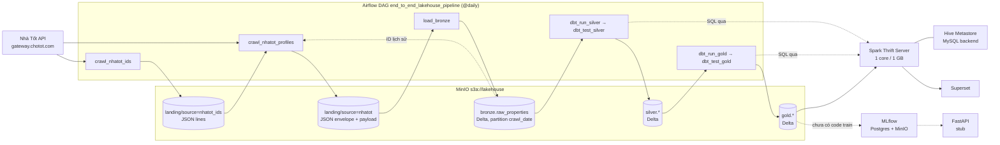

# Kiến trúc hệ thống — Lakehouse BĐS Nhà Tốt

Tài liệu mô tả kiến trúc hiện tại của dự án (nhánh `develop`, cập nhật 19/10/2026): dữ liệu đi qua những tầng nào, mỗi tầng xử lý gì, và đánh giá chỗ nào đã ổn, chỗ nào còn rủi ro hoặc chưa làm xong.

Chi tiết thiết kế star schema của Gold nằm ở [dbt/STAR_SCHEMA_DESIGN.md](../dbt/STAR_SCHEMA_DESIGN.md). Tài liệu này không lặp lại phần đó mà tập trung vào toàn bộ luồng và đánh giá.

> Ghi chú: [README.md](../README.md) và [SUPERSET_CORRECT_SCHEMAS.md](../SUPERSET_CORRECT_SCHEMAS.md) đang mô tả phiên bản cũ (`stg_properties`, `fct_properties`, `fct_daily_summary`, `bronze/json/*.jsonl`). Những bảng đó không còn tồn tại. Khi hai tài liệu mâu thuẫn, tin tài liệu này và code.

---

## 1. Mục tiêu

Thu thập hằng ngày tin rao bất động sản TP.HCM từ API công khai của Nhà Tốt (Chợ Tốt), lưu lại lịch sử từng lần crawl, và phục vụ ba bài toán:

1. **Dự đoán giá bán**: bảng feature `gold.ml_price_features`.
2. **Xu hướng giá theo khu vực**: `gold.agg_price_trend_weekly` / `_monthly`.
3. **Nguồn cung và thanh khoản** (tin mới, tin gỡ, giảm giá): `gold.agg_market_supply_weekly`.

---

## 2. Sơ đồ tổng thể



### Thành phần

| Service (compose) | Vai trò | Cổng host | Trạng thái |
|---|---|---|---|
| `minio`, `minio-init` | Object storage, tạo bucket `lakehouse` và `mlflow` | 9000, 9001 | Đang dùng |
| `mysql` | Backend của Hive Metastore | 3308 | Đang dùng |
| `hive-metastore` | Catalog cho schema `bronze`/`silver`/`gold` | 9083 | Đang dùng |
| `spark-master`, `spark-worker-1/2` | Cluster Spark 3.3.2 (Bitnami), Delta 2.2.0 | 7077, 8081 | Đang dùng |
| `spark-thrift-server` | Cổng SQL cho dbt và Superset | 10000, 4040 | Đang dùng |
| `mysql-airflow`, `airflow-webserver`, `airflow-scheduler` | Airflow 2.6.1, LocalExecutor | 8088 | Đang dùng |
| `superset` | Dashboard, đọc Gold qua Thrift | 8089 | Đang dùng |
| `postgres` | Backend của MLflow | 5433 | Đang dùng |
| `mlflow` | Tracking / model registry | 5001 | Chạy, **chưa có code train ghi vào** |
| `fastapi` | API dự đoán giá | 8000 | **Chỉ có endpoint `/` trả `ok`** |
| `kafka` | — | 9094 | **Không có code nào dùng** |
| [app/](../app/) (Streamlit) | — | — | Có Dockerfile, **không có `main.py`, không có trong compose** |

---

## 3. Luồng chạy hằng ngày

DAG: [airflow/dags/end_to_end_pipeline.py](../airflow/dags/end_to_end_pipeline.py)

```
crawl_nhatot_ids → crawl_nhatot_profiles → load_bronze → dbt_run_silver → dbt_test_silver → dbt_run_gold → dbt_test_gold
```

- `run_id` lấy từ `logical_date`, `crawl_date` lấy từ `data_interval_end`, đều theo giờ Việt Nam. Hai giá trị này cố định cho một DAG run, nên khi task retry, nó ghi lại đúng thư mục cũ. Nhờ vậy có thể chạy lại an toàn.
- Cluster có 4 core: crawler lấy tối đa 3, Thrift giữ 1, để Superset không bị treo khi crawler đang chạy.
- Spark job chạy client mode trong container Airflow. Driver đọc jar trong [airflow/jars/](../airflow/jars/), executor dùng jar có sẵn trong image Spark. Không dùng `--packages` để tránh tải lại từ Maven mỗi lần chạy.
- Gold chỉ được build sau khi test Silver đạt (quality gate).

---

## 4. Từng tầng

### 4.1 Ingestion — crawl ID

Script: [scripts/crawl_nhatot_ids.py](../scripts/crawl_nhatot_ids.py)

- Duyệt 22 `area_v2` (các quận/huyện cũ của TP.HCM, `region_v2=13000`) × 2 loại giao dịch (`s` = bán, `u` = thuê). Mỗi tổ hợp phân trang 50 tin, offset tối đa 19.950. Mỗi tổ hợp là một task Spark (`parallelize` + `flatMap`).
- Retry 3 lần, backoff mũ khi gặp 429/5xx. HTTP 400 nghĩa là đã hết trang.
- Output: `landing/source=nhatot_ids/crawl_date=…/run_id=…/part-*` cùng file `audit/` ghi số tin bán/thuê/tổng.
- Idempotent: nếu đã có `_SUCCESS` và `audit/_SUCCESS` thì bỏ qua. Nếu chỉ có thư mục dở dang thì xoá rồi ghi lại.

**Ổn**
- Không âm thầm nhảy sang offset kế tiếp khi một trang lỗi.
- Có file audit cho từng lần chạy.
- Ghi dữ liệu theo kiểu all-or-nothing nhờ cờ `_SUCCESS`.

**Chưa ổn**
- **Mỗi area bị gọi API hai lần.** Request không truyền loại giao dịch. Scope `(area, 's')` và `(area, 'u')` tải cùng các trang rồi mới lọc `type` phía client. Số request vì thế gấp đôi, và giới hạn 20.000 tin áp lên tổng bán + thuê của area chứ không phải từng loại. Nên lọc phía API (nếu API hỗ trợ tham số loại tin), hoặc crawl mỗi area một lần rồi tách theo `type`.
- **Không biết khi nào bị cắt.** Nếu một area có nhiều hơn 20.000 tin, phần dư mất mà không có cảnh báo. Khi một trang lỗi hết 3 lần, script dừng scope đó và cũng không ghi gì vào audit. Audit nên có thêm `scopes_failed` và `scopes_hit_max_offset`, đồng thời fail task khi số tin giảm mạnh so với lần chạy trước.
- **Địa giới hành chính.** Danh sách `AREAS` là mã quận/huyện cũ. Từ 07/2025 Việt Nam bỏ cấp huyện và TP.HCM sáp nhập với Bình Dương, Bà Rịa – Vũng Tàu. Cần kiểm tra Nhà Tốt có đổi `region_v2`/`area_v2` không. Nếu có đổi, cả phạm vi crawl lẫn `dim_location.area_zone` (dựa trên tiền tố "Quận"/"Huyện") sẽ sai.

### 4.2 Ingestion — crawl profile (chi tiết tin)

Script: [scripts/crawl_nhatot_profiles.py](../scripts/crawl_nhatot_profiles.py)

- Danh sách cần crawl = **ID tìm thấy hôm nay ∪ mọi ID từng crawl thành công trong Bronze**, trừ các ID đã trả 404/410 liên tiếp từ `--max-consecutive-gone` lần trở lên (DAG đặt là 1). Crawl lại tin cũ để theo dõi thay đổi giá. Tin bị gỡ sẽ được suy ra ở Gold dựa trên việc tin vắng mặt.
- Mỗi partition Spark chạy một `ThreadPoolExecutor` (4 luồng HTTP). Mỗi luồng giữ một `requests.Session` riêng, tạo `threading.local` bên trong partition để PySpark có thể pickle hàm.
- **Mọi** kết quả đều được ghi, kể cả request lỗi: envelope có `http_status`, `error`, `payload=null`. Toàn bộ crawl và ghi Landing chạy trong một Spark action duy nhất, không cache payload lớn.
- Output: `landing/source=nhatot/crawl_date=…/run_id=…/part-*`.

**Ổn**
- Envelope chuẩn (`source`, `source_listing_id`, `snapshot_id`, `crawl_timestamp`, `http_status`, `error`, `payload`). Payload gốc được giữ nguyên nên có thể replay.
- Ghi cả request lỗi, nên Silver phân biệt được tin bị gỡ (404) với lỗi mạng.
- Đã bỏ được bước audit tốn RAM. Bộ nhớ được tinh chỉnh cho máy 8 GB.

**Chưa ổn**
- Không có thống kê lỗi cho cả lần chạy (tỷ lệ 429/5xx). Phải đọc log từng partition mới biết. Nên ghi một file `audit/` giống bước crawl ID, và fail task khi tỷ lệ lỗi vượt ngưỡng.
- Danh sách ID lịch sử được đọc từ toàn bộ Bronze mỗi ngày. Chi phí sẽ tăng dần theo lịch sử. Có thể giới hạn bằng `--historical-lookback-days` (hiện đặt 0 = không giới hạn) hoặc dùng `silver.listing_current`.
- Một tin còn trả 200 nhưng đã ẩn hoặc hết hạn (`payload.ad.status`/`state`) vẫn được crawl mãi. Hai trường này hiện chỉ dùng trong `content_hash`, chưa dùng để xác định trạng thái.
- [scripts/crawl_nhatot.py](../scripts/crawl_nhatot.py) là crawler gộp đời cũ (giới hạn 35k bán / 15k thuê, bỏ request lỗi). DAG không còn dùng nó. Nên xoá hoặc chuyển vào thư mục `legacy/` để tránh nhầm.

### 4.3 Landing

`s3a://lakehouse/landing/source=<nguồn>/crawl_date=YYYY-MM-DD/run_id=…/`

Đây là vùng đệm bất biến giữa crawler và Bronze. Crawler chỉ ghi file, không đụng tới Delta hay Hive. Bronze có thể nạp lại bất kỳ lần chạy nào (ví dụ [load_all.sh](../load_all.sh) dùng để nạp lại các lần crawl `legacy_*`).

**Ổn**: tách biệt rõ phần thu thập và phần nạp. Partition theo ngày và run giúp dễ truy vết.
**Chưa ổn**: chưa có chính sách lưu trữ (lifecycle) cho Landing, nên dữ liệu thô JSON sẽ tăng mãi.

### 4.4 Bronze — `bronze.raw_properties`

Script: [scripts/load_bronze.py](../scripts/load_bronze.py) (chạy tay bằng [scripts/load_bronze.sh](../scripts/load_bronze.sh))

- Đọc JSON từ Landing ở chế độ PERMISSIVE, Spark tự suy ra schema. Kiểm tra bắt buộc phải có `source_listing_id` và `crawl_timestamp`.
- Chuẩn hoá kỹ thuật: bổ sung cột thiếu cho file định dạng cũ, ép kiểu, thêm `_source_file`, `_ingested_at`, dedup theo `(source, source_listing_id, snapshot_id)`.
- Ghi bằng `MERGE` vào Delta tại `s3a://lakehouse/bronze/source=nhatot/raw_properties`, partition theo `crawl_date`, bật `schema.autoMerge`. Đăng ký vào Hive.
- Có `--validate-only` để chạy thử.

**Ổn**
- Nạp lại cùng một run không tạo bản ghi trùng (MERGE theo khoá tự nhiên).
- Payload giữ nguyên dạng struct nên dbt truy cập được `payload.ad.*`.
- Lineage tới tận file nguồn (`_source_file`).
- Đã kiểm chứng chạy được trên máy 8 GB (xem README).

**Chưa ổn**
- ~~MERGE quét toàn bảng~~ **Đã sửa:** điều kiện MERGE giờ có `t.crawl_date IN (<các ngày của batch>)`, nên Delta chỉ đọc các partition của lần chạy đó.
- **Schema suy ra theo từng file.** Nếu API đổi kiểu một trường (ví dụ `price` có ngày là số, có ngày là chuỗi), `autoMerge` không xử lý được và MERGE sẽ lỗi. Hiện chưa có schema cố định hay bước kiểm tra schema drift.
- Bronze được `OPTIMIZE` hằng tuần (xem mục 6).

### 4.5 Silver (dbt, schema `silver`)

Thư mục: [dbt/models/staging/](../dbt/models/staging/), [dbt/models/intermediate/](../dbt/models/intermediate/), [dbt/models/silver/](../dbt/models/silver/)

```
bronze.raw_properties
  └─ stg_nhatot_properties   (incremental, merge theo observation_id)
       ├─ listing_quarantine   (quan sát không hợp lệ)
       ├─ int_crawl_snapshots  (1 dòng / lần crawl: thứ tự, độ đầy đủ, initial load)
       │    └─ int_listing_removals (thời điểm và căn cứ gỡ tin) ─────────────────► Gold
       └─ int_listing_changes  (lag giá / content_hash → change_type)
            └─ listing_history (VIEW trên int_listing_changes)
                 ├─ listing_current (bản mới nhất của mỗi tin)
                 └─ int_listing_enriched (+ outlier, + cờ snapshot) ───────────────► Gold
```

**`stg_nhatot_properties`** ([sql](../dbt/models/staging/nhatot/stg_nhatot_properties.sql)): mỗi dòng là một tin trong một lần crawl.
- Incremental theo `_ingested_at >= max(_ingested_at)`, MERGE theo `observation_id = sha2(source||id||snapshot_id)`.
- Trích xuất và ép kiểu khoảng 60 cột từ payload: giá, diện tích, ngang/dài, phòng, tầng, vị trí (id và tên), lat/long, pháp lý (bỏ các mã số thô), dự án (`''` → NULL), đặc điểm lô đất từ `pty_characteristics` (hẻm xe hơi, mặt tiền, nở hậu…), số điện thoại đã hash, `posted_at` (`orig_list_time`, nếu không có thì `list_time`).
- `content_hash` để phát hiện tin có nội dung thay đổi.
- Kiểm tra chất lượng: mảng `quality_errors` gồm 17 luật (HTTP_ERROR, MISSING_PRICE, INVALID_AREA, MISSING_LOCATION, lat/long ngoài miền…), từ đó suy ra `primary_quality_flag` và `is_valid_observation`.
- Hai cờ nghiệp vụ: `is_market_eligible` (bán/thuê, giá và diện tích dương, thuộc TP.HCM), `is_price_training_eligible` (thêm điều kiện là tin bán, có quận và loại BĐS).

**`int_listing_changes` / `listing_history`**: chỉ lấy quan sát hợp lệ. Dùng `lag` theo thời gian crawl để gán `NEW` / `PRICE_CHANGED` / `UPDATED` / `UNCHANGED` và tính `price_change_vnd/pct`, `first_seen_at`, `last_seen_at`.

**`listing_current`**: quan sát hợp lệ mới nhất của mỗi `listing_key`.

**`listing_quarantine`**: các quan sát `is_valid_observation = false`. Không xoá, giữ lại để điều tra.

**`int_listing_enriched`**: thêm hai luật mà Gold cần:
- `is_price_outlier`: giá/m² hoặc diện tích nằm ngoài [p1, p99] **trong từng phân khúc** (giao dịch × loại BĐS), tính trên `listing_current`. Chỉ gắn cờ, không xoá.
- `is_full_snapshot`, `is_initial_load_snapshot`: lấy từ `int_crawl_snapshots`.

**`int_crawl_snapshots`** ([sql](../dbt/models/intermediate/int_crawl_snapshots.sql)): mỗi dòng là một lần crawl. Các lần crawl được sắp theo `min(crawl_timestamp)`, **không theo chuỗi `snapshot_id`**. Một lần crawl được coi là đầy đủ khi số tin "online" (mọi phản hồi trừ 404/410, kể cả 429 và tin bị quarantine) ≥ 50% lần lớn nhất. Model cũng tính `next_full_snapshot_id` và `is_initial_load`. Đây là nguồn duy nhất cho các khái niệm trên; trước đây chúng được tính lặp ở ba nơi, mỗi nơi một kiểu.

**`int_listing_removals`** ([sql](../dbt/models/intermediate/int_listing_removals.sql)): sau lần cuối tin online, tin bị coi là gỡ ở mốc sớm nhất giữa 404/410 (`GONE_STATUS`) và lần crawl đầy đủ kế tiếp không chạm tới tin (`ABSENT_FROM_FULL_SNAPSHOT`). Model chỉ dùng phép join bằng nhau qua `next_full_snapshot_id`, không nhân chéo tin × snapshot.

**Ổn**
- Quarantine thay vì xoá, kèm test đối soát `staging = history + quarantine` và test history ∩ quarantine = ∅.
- Mỗi lỗi chất lượng có mã riêng, gom thành mảng. Dễ thống kê lỗi trên dashboard ([superset/ml_data_quality_queries.sql](../superset/ml_data_quality_queries.sql)).
- Ngưỡng outlier tính theo phân khúc và trên trạng thái mới nhất, nên tin bị crawl nhiều lần không bị tính trọng số cao hơn.
- Số điện thoại không lưu dạng thô.
- Các ngưỡng nằm trong `vars` của [dbt_project.yml](../dbt/dbt_project.yml), không hard-code.

**Chưa ổn**
- **Rebuild toàn bộ mỗi ngày.** Trừ staging, mọi model Silver là `table` và tính window function trên toàn bộ lịch sử. Với khoảng 50k tin × 365 lần crawl, mỗi năm có khoảng 18 triệu dòng, chạy trên một Thrift server 1 core / 1 GB. Đây sẽ là nút thắt đầu tiên. `listing_history` đã chuyển thành view nên bớt được một lần ghi lại toàn bộ lịch sử mỗi ngày. Bước tiếp theo: chuyển `int_listing_changes` sang incremental (chỉ cần quan sát cuối của mỗi tin cộng với batch mới).
- **Quarantine trộn hai loại.** Lỗi dữ liệu thật (MISSING_PRICE…) nằm chung với tín hiệu "tin đã bị gỡ" (404). Quarantine phồng lên theo số 404, và dashboard chất lượng dữ liệu bị lệch. Nên tách 404/410 thành một trạng thái riêng (ví dụ `GONE`) hoặc một bảng riêng.
- **Hash số điện thoại không có salt.** Số điện thoại Việt Nam chỉ khoảng 10⁹ giá trị, nên `sha2(phone)` có thể brute-force ngược lại trong vài phút. Ngoài ra `description` và `payload` ở Bronze vẫn có thể chứa số điện thoại thô. Nên dùng HMAC với secret và ghi rõ trong luận văn rằng Bronze chứa dữ liệu cá nhân.
- **Cờ outlier của dữ liệu cũ thay đổi theo thời gian.** Ngưỡng outlier tính lại mỗi ngày trên `listing_current`, nên một quan sát cũ có thể hôm nay là outlier, mai lại không. Điều này chấp nhận được nhưng cần ghi chú khi so sánh số liệu giữa các ngày.
- **Ngưỡng `full_snapshot_min_ratio = 0.5` khá lỏng.** Lần crawl bị rate-limit giờ không còn bị coi là thiếu nữa. Nhưng lần crawl thiếu do bước crawl ID bị cắt vẫn có thể đạt ngưỡng 50%, và khi đó những tin không được chạm tới sẽ bị tính là đã gỡ. Nên so với lần crawl đầy đủ gần nhất (ví dụ ≥ 85–90%), hoặc dựa vào audit của bước crawl ID.
- `listing_status` là alias trùng với `change_type`, giữ lại chỉ để tương thích ngược.

### 4.6 Gold (dbt, schema `gold`)

Thư mục: [dbt/models/gold/](../dbt/models/gold/), thiết kế chi tiết: [STAR_SCHEMA_DESIGN.md](../dbt/STAR_SCHEMA_DESIGN.md)

| Nhóm | Bảng | Grain |
|---|---|---|
| Dimension | `dim_date`, `dim_location`, `dim_property_type`, `dim_legal_status`, `dim_project` | 1 thành viên. Có thành viên "Không rõ"/"Không thuộc dự án" |
| Fact | `fct_listing_snapshot` (periodic) | tin × lần crawl |
| | `fct_listing` (accumulating) | 1 tin: trạng thái mới nhất, giá ban đầu, số lần đổi giá, `removed_at`, `is_active` |
| | `fct_listing_event` (transaction) | 1 sự kiện: `NEW` / `PRICE_CHANGED` / `UPDATED` / `REMOVED` |
| Mart | `agg_price_trend_weekly/monthly` (macro [price_trend.sql](../dbt/macros/price_trend.sql)) | kỳ × geo_level × geo_name × giao dịch × loại BĐS |
| | `agg_market_supply_weekly` | cùng grain với mart giá tuần |
| ML | `ml_price_features` | 1 tin bán (trạng thái mới nhất), đủ điều kiện, không phải outlier |

Các quyết định chính:
- Surrogate key `xxhash64` được sinh bởi cùng một macro ([gold_keys.sql](../dbt/macros/gold_keys.sql)) cho cả dim và fact. NULL map về thành viên "unknown".
- **Quy tắc gỡ tin**: lấy từ `int_listing_removals` (mục 4.5). Gold rebuild toàn bộ mỗi lần chạy, nên tin xuất hiện lại sẽ tự động không còn bị tính là gỡ.
- **Tồn kho ban đầu**: `fct_listing.is_initial_inventory`, được cả `fct_listing_event.is_initial_load` lẫn hai mart dùng chung.
- Mart đếm mỗi tin một lần mỗi kỳ, tính median trực tiếp từ dữ liệu tin cho mọi cấp địa lý bằng `GROUPING SETS`, có cờ `is_reliable`, và chỉ tính % thay đổi khi kỳ trước liền kề.
- Bảng ML chống leakage: chỉ giữ thuộc tính người dùng có thể nhập khi hỏi giá, không có feature tổng hợp theo khu vực. Có `posted_date`/`observed_date` để chia train/test theo thời gian.

**Ổn**
- Mô hình Kimball đúng chuẩn, với ba loại fact có vai trò rõ ràng.
- Có test `relationships` cho mọi khoá ngoại, test đối soát Gold ↔ Silver, và test đối soát event ↔ fct_listing.
- Đã xử lý các bẫy số liệu thường gặp: đếm trùng theo số lần crawl, lấy trung bình của các median, mix shift giữa loại BĐS, kỳ không liền kề.
- Giới hạn của dữ liệu được ghi rõ trong tài liệu: giá rao không phải giá giao dịch, tin gỡ chỉ là proxy cho giao dịch, có survivorship bias.

**Đã sửa (19/10/2026) — các lỗi làm bảng lệch nhau**
1. ~~Lỗi tạm thời (429/5xx) hoặc tin bị xoá giá bị tính là đã gỡ~~. Quyết định gỡ tin giờ dựa trên mọi quan sát ở staging, không chỉ các quan sát hợp lệ. Có test [assert_removed_listings_not_online](../dbt/tests/assert_removed_listings_not_online.sql) bảo vệ.
2. ~~`is_initial_load` so sánh chuỗi `snapshot_id`~~. Giờ sắp theo thời gian bắt đầu crawl (`int_crawl_snapshots`).
3. ~~`new_listing_count` của hai mart lệch nhau~~. Cả hai cùng loại tồn kho ban đầu qua `fct_listing.is_initial_inventory`.
4. ~~`ml_price_features` chứa tin trùng giữa các môi giới~~. Đã gộp, có thêm cột `duplicate_count`.

**Chưa ổn — thiết kế / hiệu năng**
- Toàn bộ Gold rebuild mỗi ngày. Hiện chấp nhận được, nhưng chi phí tăng cùng với Silver.
- `dim_project` dùng tên dự án làm khoá, nên hai dự án trùng tên ở hai quận khác nhau bị gộp làm một.
- `ml_price_features`: (a) phép gộp tin trùng yêu cầu trùng **chính xác** giá và diện tích, nên bản sao chênh giá một chút (môi giới đội giá) vẫn lọt qua. Khi train vẫn nên chia theo nhóm hoặc theo thời gian. (b) Ngưỡng outlier được tính trên toàn bộ dữ liệu, kể cả phần sẽ làm test, nên có leakage nhẹ ở khâu lọc. (c) lat/long của Nhà Tốt thường là toạ độ gần đúng, nên kiểm tra phân bố trước khi dùng làm feature khoảng cách.

### 4.7 Serving

**Superset** ([superset/](../superset/)): kết nối `hive://spark-thrift-server:10000?auth=NOSASL`. Ba bộ query SQL Lab được viết sẵn theo mạch câu chuyện: tổng quan thị trường, các yếu tố ảnh hưởng giá, và chất lượng dữ liệu cho ML. Timeout được nâng lên 280 giây, cache kết quả 24 giờ.
- Ổn: query có chú thích, quy ước đơn vị, lọc `is_reliable`, loại nhóm có quá ít tin.
- Chưa ổn: dashboard chỉ tồn tại trong metadata của Superset (SQLite trong volume), không có export nằm trong git, nên mất volume là mất dashboard. Biến `SQLALCHEMY_DATABASE_URI` trong compose không được [superset_config.py](../superset/superset_config.py) đọc tới, dễ gây hiểu nhầm. Container chạy `pip install` mỗi lần khởi động. Thrift 1 core dùng chung với dbt, nên trong lúc DAG chạy, dashboard sẽ chậm.

**MLflow / FastAPI**: hạ tầng đã có (Postgres backend, artifact trên MinIO), nhưng **repo chưa có code huấn luyện, chưa ghi model vào registry, và API chưa có endpoint dự đoán**. Bài toán 1 hiện mới dừng ở bảng feature.

---

## 5. Kiểm thử và chất lượng dữ liệu

| Lớp | Có gì |
|---|---|
| Staging | `unique`/`not_null` khoá, `accepted_values`, [assert_price_training_eligible](../dbt/tests/assert_price_training_eligible.sql) |
| Silver | [assert_staging_reconciles](../dbt/tests/assert_staging_reconciles.sql), [assert_history_quarantine_disjoint](../dbt/tests/assert_history_quarantine_disjoint.sql), [assert_current_valid](../dbt/tests/assert_current_valid.sql) |
| Gold | `relationships` fact→dim, `dbt_expectations` (miền giá trị, tính duy nhất của grain), [assert_gold_listing_reconciles_silver](../dbt/tests/assert_gold_listing_reconciles_silver.sql), [assert_listing_events_reconcile](../dbt/tests/assert_listing_events_reconcile.sql), [assert_ml_features_clean](../dbt/tests/assert_ml_features_clean.sql) |
| Python (crawler, loader) | **Chưa có test** |

**Hạn chế của quality gate**: `dbt test` chạy **sau khi** bảng đã được ghi đè. Nếu `dbt_test_gold` fail, Superset vẫn đọc Gold mới (sai), chỉ có DAG báo đỏ. Silver cũng tương tự. Cách khắc phục:
- Theo mô hình write–audit–publish: build vào schema tạm (`gold_staging`), test xong mới swap.
- Hoặc tối thiểu, khi test fail thì rollback bằng Delta time travel (`RESTORE TABLE … TO VERSION AS OF …`).

Ngoài ra chưa có test về **khối lượng dữ liệu**, ví dụ số tin hôm nay so với hôm qua, hay tỷ lệ quarantine theo ngày. Đây là loại lỗi crawler hay gặp nhất.

---

## 6. Hạ tầng và vận hành

**Ổn**
- Toàn bộ stack chạy bằng một lệnh `docker compose`. Jar được ghim phiên bản, tương thích với Spark 3.3.2 / Delta 2.2.0 / Hadoop 3.3.2. Debian snapshot được ghim để build lại được.
- Ngân sách RAM/CPU được tính kỹ cho máy 8 GB và có ghi lại lý do (README, comment trong DAG).
- `.env` đã nằm trong `.gitignore`.

**Chưa ổn**
- ~~Không bảo trì Delta~~ **Đã thêm:** task `is_maintenance_day → delta_maintenance` ở cuối DAG chạy vào Chủ nhật hằng tuần (macro [delta_maintenance.sql](../dbt/macros/delta_maintenance.sql)). Task này `OPTIMIZE` Bronze và chạy `VACUUM … RETAIN 168 HOURS` cho Bronze cùng mọi bảng Silver/Gold, giữ lại 7 ngày time travel để có thể rollback.
- **Secret nằm trong code**: `minio/minio123` trong [spark-defaults.conf](../spark/spark-defaults.conf), [metastore-site.xml](../hive-metastore/metastore-site.xml) và giá trị mặc định của DAG. `reip/reip123` và `admin/admin` nằm trong compose và metastore config. Môi trường dev thì chấp nhận được, nhưng nên ghi rõ trong luận văn và đọc từ `.env`.
- **Airflow mount `/var/run/docker.sock`**, còn [active_docker_deamon.sh](../active_docker_deamon.sh) chạy `chmod 666` cho socket. Như vậy container Airflow có quyền root trên máy host. DAG hiện không cần quyền này, nên bỏ mount.
- Image chưa ghim phiên bản: `minio/minio:latest`, `ghcr.io/mlflow/mlflow:latest`. Build lại vào thời điểm khác có thể ra kết quả khác.
- Chưa có cảnh báo khi DAG fail hay SLA. `retries=1` cho cả các task crawl dài.
- Phải tạo connection `spark_default` bằng tay (README). Có thể khai báo qua biến môi trường `AIRFLOW_CONN_SPARK_DEFAULT`.
- Rác trong repo: [airflow/jars/](../airflow/jars/) có jar không dùng (`hadoop-aws-3.3.4`, `aws-java-sdk-1.12.367`, `s3-2.18.41`, `mysql-connector-java-8.0.19`). [env.sh](../env.sh) trỏ tới `real_estate_data/` đang rỗng. Service `kafka` không ai dùng, chỉ tốn RAM trên máy 8 GB.

---

## 7. Tổng hợp đánh giá

| Hạng mục | Đánh giá | Ghi chú |
|---|---|---|
| Tách Landing / Bronze, idempotency, lineage | ✅ Tốt | `_SUCCESS`, MERGE theo khoá tự nhiên, `_source_file` |
| Theo dõi lịch sử giá theo từng lần crawl | ✅ Tốt | Crawl lại ID lịch sử, `change_type`, ba loại fact |
| Data quality ở Silver | ✅ Tốt | Mảng lỗi, quarantine, test đối soát |
| Thiết kế Gold / mart | ✅ Tốt | Đã xử lý đúng các bẫy thống kê |
| Logic "tin bị gỡ" | ✅ Đã sửa | Dựa trên mọi quan sát; còn ngưỡng full snapshot 0.5 hơi lỏng |
| `is_initial_load`, `new_listing_count` | ✅ Đã sửa | Sắp theo thời gian; một định nghĩa dùng chung |
| Độ phủ crawl ID | ⚠️ Cần sửa | Gọi API trùng ×2, không phát hiện bị cắt ở 20k, không đếm scope lỗi |
| Khả năng mở rộng | ⚠️ Rủi ro | Silver/Gold vẫn rebuild toàn bộ (đã sửa MERGE Bronze, thêm VACUUM, `listing_history` thành view) |
| Quality gate | ⚠️ Một nửa | Test chạy sau khi đã ghi đè bảng |
| Quyền riêng tư | ⚠️ Cần sửa | Hash số điện thoại không salt |
| ML (train, registry, serving) | ❌ Chưa làm | Mới có bảng feature; MLflow và FastAPI là khung rỗng |
| Tài liệu | ⚠️ | README và SUPERSET_CORRECT_SCHEMAS đã lỗi thời |
| Bảo mật hạ tầng | ⚠️ Dev-only | Secret trong file config, mount docker.sock |

---

## 8. Đề xuất theo thứ tự ưu tiên

**P0 — sửa để số liệu đúng** ✅ đã xong (xem mục 4.6)

**P1 — hoàn thiện bài toán 1**
4. Viết script train (đọc `gold.ml_price_features`, chia train/test theo `posted_date`, log lên MLflow, đăng ký model).
5. Thêm endpoint `/predict` vào FastAPI, load model từ registry.

**P2 — ổn định vận hành**
6. Audit cho crawl ID và crawl profile (số scope lỗi, scope chạm 20k, tỷ lệ 429/5xx). Fail task khi số tin giảm bất thường.
7. ~~Thêm `crawl_date` vào điều kiện MERGE của Bronze. Thêm task `OPTIMIZE`/`VACUUM` hằng tuần.~~ ✅
8. Write–audit–publish hoặc rollback bằng time travel khi test fail.
9. Bỏ gọi API trùng ở bước crawl ID.

**P3 — dọn dẹp**
10. Cập nhật README. Xoá `crawl_nhatot.py`, các jar thừa, service `kafka`, thư mục `app/` nếu không dùng.
11. Đưa secret ra `.env`, bỏ mount docker.sock, ghim phiên bản image.
12. Export dashboard Superset (`superset export-dashboards`) vào git.
13. Kiểm tra lại địa giới hành chính mới của TP.HCM trên Nhà Tốt.
