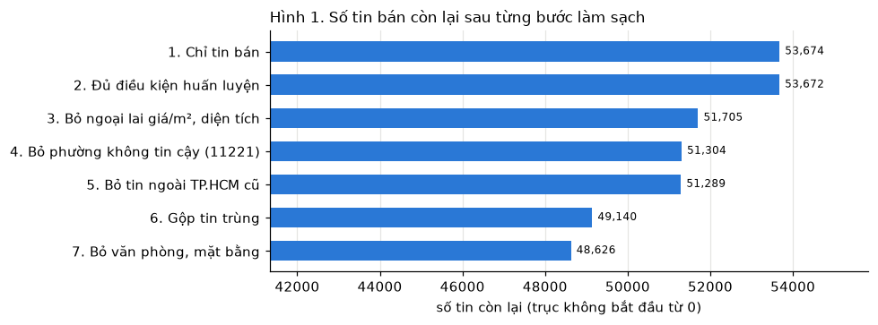
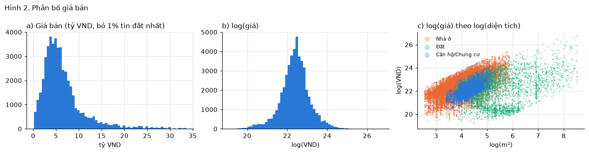
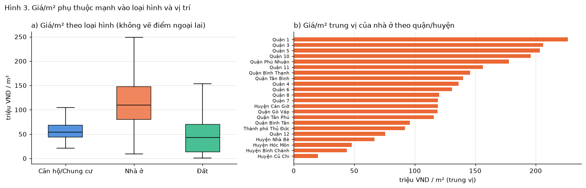
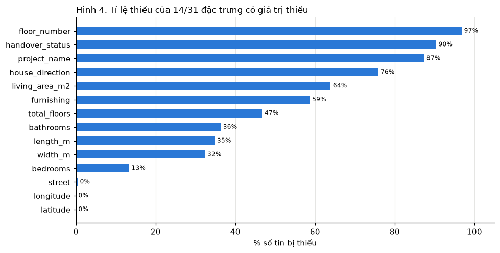
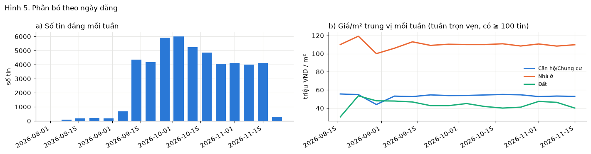
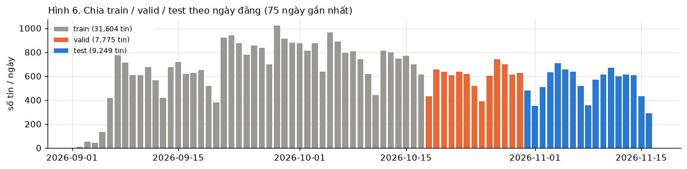
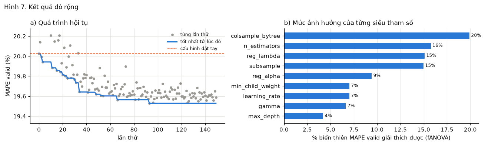
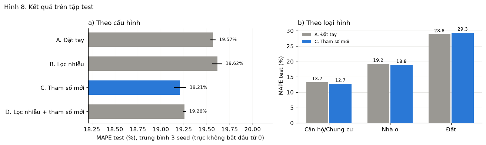
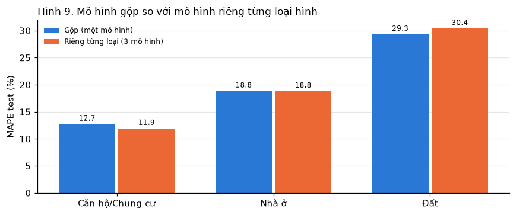
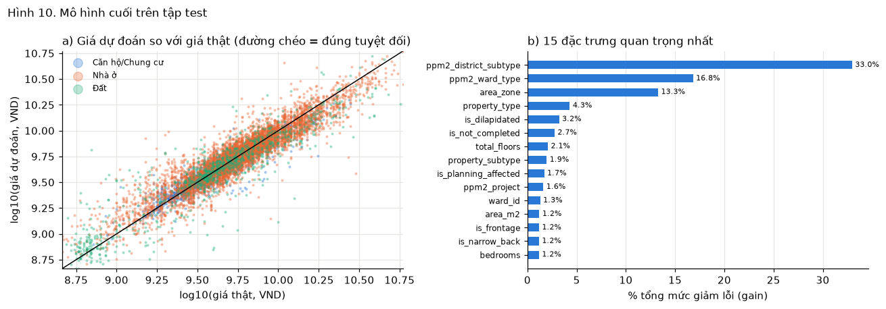

# 4.3. MÔ HÌNH DỰ ĐOÁN GIÁ

## 4.3.1. Xác định bài toán mô hình

Trong đề tài này, mô hình học máy được xây dựng để giải quyết bài toán **dự đoán giá rao bán bất động sản tại TP. Hồ Chí Minh** từ các thuộc tính mà người dùng có thể cung cấp khi hỏi giá, dựa trên dữ liệu đã được làm sạch và tổ chức ở tầng Gold của hệ thống Data Lakehouse. Bài toán được xác định là bài toán hồi quy, với biến mục tiêu là:

`log(price_vnd / area_m2)` (giá rao bán trên mỗi mét vuông, thang logarit)

Mô hình học giá/m² thay vì tổng giá vì hai lý do. Thứ nhất, giá nhà lệch phải rất mạnh (phần lớn tin dưới 10 tỷ nhưng đuôi kéo tới hàng trăm tỷ); lấy logarit đưa phân phối về gần đối xứng và biến sai số tương đối thành sai số tuyệt đối, khớp với chỉ số MAPE dùng để đánh giá. Thứ hai, với căn hộ và nhà ở (87% dữ liệu) giá tăng gần tỉ lệ với diện tích, nên giá/m² tách phần "to hay nhỏ" khỏi phần "đắt hay rẻ" và có độ phân tán nhỏ hơn hẳn. Khi dự đoán, mô hình cộng lại `log(area_m2)` và lấy mũ để trả về tổng giá bằng VND, nên API và người dùng vẫn nhận được giá của cả bất động sản.

Dữ liệu đầu vào của mô hình là bảng đặc trưng `gold.ml_price_features`, gồm các nhóm đặc trưng chính:

- Thông tin diện tích và kích thước: diện tích, diện tích sử dụng, chiều ngang, chiều dài, số tầng, tầng số.
- Thông tin loại hình: loại bất động sản, loại con, nhóm chuẩn hóa.
- Thông tin vị trí: quận, khu vực nội/ngoại thành, phường, đường, dự án, tọa độ.
- Thông tin số phòng, hướng nhà, nội thất, tình trạng bàn giao.
- Thông tin pháp lý và đặc điểm: nhóm pháp lý, có sổ, hẻm xe hơi, mặt tiền, nở hậu, tóp hậu, nhà nát, chưa hoàn công, dính quy hoạch.

Nguyên tắc chọn đặc trưng là **chỉ dùng thông tin biết được tại thời điểm hỏi giá**: các cột mô tả hành vi tin đăng (số ngày trên thị trường, số lần đổi giá, người đăng là môi giới hay cá nhân) bị loại vì người dùng không có chúng khi nhập một căn nhà mới, và vì chúng có thể rò rỉ thông tin về giá.

Chỉ số đánh giá chính là **MAPE** (Mean Absolute Percentage Error), sai số tương đối trung bình giữa giá dự đoán và giá rao, vì nó dễ hiểu với người dùng ("lệch trung bình bao nhiêu phần trăm") và dùng được chung cho mọi phân khúc giá. Kèm theo là **MdAPE** (trung vị sai số tương đối, ít bị ảnh hưởng bởi vài tin sai rất nhiều), **tỉ lệ tin sai không quá 20%** và **R² trên thang log**. Mô hình học máy chỉ có ý nghĩa khi tốt hơn rõ rệt mô hình cơ sở (baseline): giá/m² trung vị của từng cặp quận × loại hình nhân với diện tích, tức cách định giá "theo mặt bằng chung".

Mục tiêu cuối cùng của mô hình là cung cấp mức giá rao tham khảo cho một bất động sản từ các thông tin đầu vào, phục vụ API dự đoán giá và giao diện web của hệ thống, đồng thời được huấn luyện lại định kỳ trong pipeline Airflow và chỉ thay thế mô hình đang chạy khi chứng minh được là tốt hơn trên cùng một tập kiểm tra.

## 4.3.2. Chuẩn bị tập dữ liệu

Dữ liệu huấn luyện được lấy từ bảng `gold.ml_price_features`, một model dbt ở tầng Gold. Bảng này được xây từ bảng fact chính `fct_listing` nối với bốn bảng chiều `dim_location`, `dim_property_type`, `dim_legal_status`, `dim_project`, lấy thêm thuộc tính chi tiết (số phòng, kích thước, tọa độ) từ quan sát mới nhất của tin ở tầng Silver. Mỗi dòng là một bất động sản bán ở trạng thái mới nhất; các tin trùng do nhiều môi giới cùng đăng một căn được gộp lại.

Quá trình lọc từ Silver xuống bảng đặc trưng gồm bảy bước, được tái hiện bằng pandas để đếm số tin mỗi bước loại và đối chiếu với bảng Gold thật (chênh 2 dòng do Spark tính phân vị xấp xỉ bằng `percentile_approx`):

| Bước | Quy tắc | Còn lại | Bị loại | Lý do |
|---|---|---|---|---|
| 0 | Toàn bộ tin trong `silver.listing_current` | 163.087 | | |
| 1 | Chỉ giữ tin bán | 53.674 | 109.413 | Mô hình dự đoán giá bán, giá thuê là bài toán khác |
| 2 | Giá > 0, diện tích > 0, thuộc TP.HCM, có quận và loại hình | 53.672 | 2 | Thiếu các trường này thì không học hay dự đoán được |
| 3 | Bỏ ngoại lai: giá/m² hoặc diện tích ngoài phân vị 1%–99% của nhóm (loại giao dịch × loại hình) | 51.705 | 1.967 | Loại tin nhập sai đơn vị, giá ảo |
| 4 | Bỏ phường mã 11221 | 51.304 | 401 | Nguồn dồn vào đây các tin không ánh xạ được sau sáp nhập 2025, tọa độ không tin cậy |
| 5 | Bỏ tin nhắc tới Bình Dương, Bà Rịa – Vũng Tàu trong tiêu đề/địa chỉ | 51.289 | 15 | Nguồn xếp nhầm vào quận cũ của TP.HCM nên quận, phường, tọa độ đều sai |
| 6 | Gộp tin trùng (cùng loại, vị trí, diện tích, số phòng, giá) | 49.140 | 2.149 | Tránh một căn nằm ở cả tập train lẫn test |
| 7 | Bỏ văn phòng, mặt bằng kinh doanh | 48.626 | 514 | Tin "bán" nhóm này chủ yếu ghi giá thuê hoặc phí sang nhượng |

*Bảng 1. Các bước lọc từ Silver đến bảng đặc trưng huấn luyện*



Từ 163.087 tin (cả thuê lẫn bán) còn 53.674 tin bán; sau làm sạch còn 48.628 tin, tức 90,6% số tin bán được giữ lại. Hai bước loại nhiều nhất là bỏ ngoại lai và gộp tin trùng (khoảng 4%).

**Quy mô dữ liệu** (phiên bản Delta 30 của bảng, chốt ngày 16/11/2026):

- Số dòng: 48.628 bất động sản bán.
- Số cột: 42 thuộc tính, trong đó 31 cột được dùng làm đặc trưng.
- Thời gian đăng tin: từ 24/07/2025 đến 16/11/2026; 84% số tin được đăng trong 60 ngày gần nhất vì hệ thống bắt đầu thu thập từ tháng 9/2026, tin cũ hơn là tin vẫn còn hiển thị lúc thu thập.
- Phạm vi: 22 quận/huyện của TP.HCM theo địa giới cũ, 315 phường, 789 dự án, 6.677 tên đường.

| Loại hình | Số tin | Tỉ lệ | Giá trung vị (tỷ) | Diện tích trung vị (m²) | Giá/m² trung vị (triệu) | Số loại con |
|---|---|---|---|---|---|---|
| Nhà ở | 35.288 | 72,6% | 5,90 | 56 | 110,0 | 4 |
| Căn hộ/Chung cư | 7.100 | 14,6% | 3,58 | 68 | 53,8 | 8 |
| Đất | 6.240 | 12,8% | 4,60 | 110 | 43,0 | 4 |

*Bảng 2. Tổng quan tập dữ liệu theo loại hình*



Độ lệch (skewness) của giá là 12,6, của log(giá) là −0,13: đây là cơ sở để mô hình học trên thang log. Quan hệ giữa giá và diện tích khác nhau theo loại hình (hệ số co giãn căn hộ 1,17, nhà ở 0,77, đất 0,28): căn hộ và nhà ở có giá tăng gần tỉ lệ với diện tích, còn đất thì không vì lô lớn thường là đất nông nghiệp hoặc chỉ một phần là thổ cư.



Giá/m² trung vị của nhà ở (110 triệu) gấp đôi căn hộ (54 triệu) và đất (43 triệu). Trong cùng loại nhà ở, quận đắt nhất (Quận 1, 226 triệu/m²) gấp 11 lần quận rẻ nhất (Huyện Củ Chi, 20 triệu/m²). Vị trí vì vậy là yếu tố quyết định giá, nên ngoài mã quận, phường, mô hình cần thêm đặc trưng mô tả trực tiếp mức giá của khu vực (mục 4.3.3, bước 4).



Phần lớn giá trị thiếu là thiếu theo cấu trúc, không phải thiếu ngẫu nhiên: đất không có phòng ngủ và số tầng, căn hộ không có chiều ngang và chiều dài, nhà ở không có "tầng số mấy". Chỉ một số cột thiếu thật sự do người đăng bỏ trống (hướng nhà 76%, nội thất 59%). Vì vậy mô hình **không điền giá trị thay thế**: cột số giữ NaN, cột phân loại nhận nhãn riêng `__missing__`, và XGBoost học hướng rẽ riêng cho giá trị thiếu ở mỗi nút.



Giá/m² trung vị theo tuần ổn định trong khoảng thời gian thu thập (nhà ở quanh 110, căn hộ quanh 54 triệu/m²), nên mô hình không dùng đặc trưng thời gian. Tuy vậy, cách đánh giá vẫn phải chia theo thời gian, vì đó là cách mô hình được dùng thật: định giá tin mới đăng.

## 4.3.3. Thực hiện huấn luyện mô hình

Quy trình huấn luyện được cài đặt trong script `scripts/train_price_model.py`, chạy như một Spark job trong pipeline Airflow (Spark chỉ dùng để đọc và ghi bảng Delta, phần học máy chạy bằng scikit-learn và XGBoost trong driver). Script gồm mười bước, mỗi bước ghi log chi tiết để có thể đối chiếu sau này.

**Bước 1: Khởi tạo.** Đọc tham số dòng lệnh (`--test-fraction 0.2`, `--tune-trials 30`, `--tune-valid-fraction 0.2`, `--max-mape-regression 0`) và mở Spark session có Hive metastore.

**Bước 2: Đọc dữ liệu.** Đọc `gold.ml_price_features` theo đúng phiên bản Delta mới nhất và ghi số phiên bản này vào MLflow, nên mỗi lần huấn luyện đều biết chính xác đã học trên dữ liệu nào. Mã quận và mã phường được ép về kiểu chuỗi vì chúng là mã phân loại, không phải đại lượng.

**Bước 3: Chia tập dữ liệu thành train, valid và test.** Dữ liệu được chia thành ba tập, mỗi tập có một vai trò riêng và không dùng lẫn cho nhau:

| Tập | Vai trò | Dùng ở đâu | Số tin | Tỉ lệ | Ngày đăng | Nhà ở | Căn hộ | Đất |
|---|---|---|---|---|---|---|---|---|
| **Huấn luyện (train)** | Cho mô hình học | Mọi lần fit | 31.604 | 65,0% | 24/07/2025 – 17/10/2026 | 71,0% | 15,3% | 13,8% |
| **Kiểm định (valid)** | Chọn siêu tham số | Bước 5 (Optuna) | 7.775 | 16,0% | 18/10 – 30/10/2026 | 75,2% | 13,5% | 11,3% |
| **Kiểm tra (test)** | Chấm điểm cuối cùng | Bước 7, chỉ một lần | 9.249 | 19,0% | 31/10 – 16/11/2026 | 75,8% | 13,3% | 10,9% |

*Bảng 3. Ba tập dữ liệu, chia theo ngày đăng (Delta v30, 48.628 tin)*

Cách chia là **theo thời gian**, không chia ngẫu nhiên. Sắp các tin theo ngày đăng từ cũ đến mới, rồi:

- Lấy 20% tin mới nhất làm **test**, cắt ở trọn ngày để không có ngày nào nằm ở hai tập.
- Phần còn lại, lấy tiếp 20% tin mới nhất làm **valid**; phần cũ nhất là **train**.



Lý do chia theo thời gian: mô hình được dùng để định giá tin **mới đăng**, nên khi đánh giá cũng phải hỏi đúng câu đó: "học trên tin cũ, dự đoán tin mới thì sai bao nhiêu?". Nếu chia ngẫu nhiên, các tin cùng một đợt mở bán, cùng dự án sẽ nằm ở cả hai phía, mô hình "nhìn thấy trước" giá của hàng xóm và cho sai số thấp hơn thực tế. Bước gộp tin trùng (Bảng 1, bước 6) cũng nhằm để một căn không nằm ở cả train lẫn test.

Ba tập được dùng theo thứ tự sau:

1. **Dò siêu tham số** (bước 5): mỗi lần thử học trên **train**, chấm trên **valid**. Bộ tham số có MAPE valid thấp nhất được chọn. Tập test chưa được đụng tới.
2. **Huấn luyện mô hình cuối** (bước 6): khi đã chốt tham số, valid không cần giữ riêng nữa, nên mô hình được học lại trên **train + valid** (39.379 tin) để có thêm dữ liệu mới nhất.
3. **Đánh giá** (bước 7): mô hình cuối chấm trên **test** đúng một lần. Vì test không tham gia học lẫn chọn tham số, con số này là ước lượng trung thực sai số khi dùng thật.

**Bước 4: Chuẩn bị đặc trưng đầu vào.** Hàm `prepare` là "hợp đồng" chung giữa pipeline huấn luyện và API: mọi đầu vào được đưa về đúng kiểu trước khi vào mô hình, và danh sách cột được ghi ra `feature_spec.json` để API dựng khung dữ liệu y hệt.

| Nhóm | Cột | Số cột | Xử lý |
|---|---|---|---|
| Số | diện tích, diện tích sử dụng, ngang, dài, phòng ngủ, phòng tắm, số tầng, tầng số, vĩ độ, kinh độ | 10 | Giữ nguyên; thiếu để NaN |
| Đúng/sai | trong dự án, hẻm xe hơi, mặt tiền, nở hậu, tóp hậu, nhà nát, chưa hoàn công, dính quy hoạch, có sổ | 9 | True/False → 1/0, thiếu → NaN |
| Phân loại ít mức | quận, khu vực, loại quận, loại hình, loại con, hướng, nội thất, bàn giao, pháp lý | 9 | Mã hóa thứ tự (OrdinalEncoder); thiếu → `__missing__`; nhãn chưa gặp → NaN |
| Phân loại nhiều mức | phường, đường, dự án | 3 | Mã hóa mục tiêu chéo (TargetEncoder, 5 fold) |
| Giá khu vực | giá/m² trung bình làm trơn và số tin của (phường × loại hình), (quận × đường × loại hình), (dự án), (quận × loại con) | 8 | AreaPriceEncoder, tính ngoài fold |

*Bảng 4. Các nhóm đặc trưng và cách xử lý*

Ba cột nhiều mức (315 phường, 789 dự án, 6.677 đường) nếu mã hóa one-hot sẽ sinh hơn 7.700 cột thưa, nên được **mã hóa mục tiêu**: mỗi nhãn thay bằng trung bình biến mục tiêu của nhãn đó, có làm trơn về trung bình chung khi nhãn ít tin. Khi huấn luyện, dữ liệu chia 5 fold và mỗi tin được mã hóa bằng 4 fold còn lại (cross-fitting), nên giá của chính tin đó không lọt vào đặc trưng của nó.

**Đặc trưng giá khu vực** (`AreaPriceEncoder`, viết riêng cho bài toán): với mỗi nhóm khu vực g, giá/m² trung bình được làm trơn về giá trung bình của loại hình với hệ số m = 5, nhóm có ít tin thì dựa nhiều hơn vào trung bình loại hình. Số tin của nhóm cũng được đưa vào làm đặc trưng để mô hình biết trung bình đó đáng tin tới đâu. Cả bốn đặc trưng giá khu vực tương quan 0,83–0,88 với biến mục tiêu. Ma trận đặc trưng cuối cùng có 39 cột.

```python
def _tree_preprocessor():
    low_card = make_pipeline(OrdinalEncoder(
        handle_unknown="use_encoded_value", unknown_value=np.nan, dtype=np.float64))
    return ColumnTransformer([
        ("num",  "passthrough",        NUMERIC + BOOLEAN),
        ("low",  low_card,             LOW_CARD),
        ("high", _high_card_encoder(), HIGH_CARD),   # SimpleImputer + TargetEncoder
        ("area", AreaPriceEncoder(),   AREA_COLUMNS),
    ], verbose_feature_names_out=False).set_output(transform="pandas")
```

**Bước 5: Dò siêu tham số bằng Optuna.** Mỗi lần thử, Optuna chọn một bộ siêu tham số, mô hình học trên tập train và được chấm MAPE trên tập valid; tập test không tham gia. Trong code, train và valid được tách từ cùng một bảng bằng ngày đăng (biến `x_fit` là train, `x_valid` là valid). Thuật toán lấy mẫu là TPE (Tree-structured Parzen Estimator): sau vài lần thử ngẫu nhiên, nó mô hình hóa vùng tham số cho kết quả tốt và tập trung lấy mẫu ở đó. Lần thử 0 luôn là bộ tham số tốt nhất của lần dò đầy đủ trước (`TUNED_PARAMS`), nên kết quả không bao giờ kém hơn.

| Siêu tham số | Ý nghĩa | Vùng dò |
|---|---|---|
| `n_estimators` | Số cây | 400 – 2000 |
| `learning_rate` | Mức đóng góp của mỗi cây | 0,01 – 0,1 (thang log) |
| `max_depth` | Độ sâu tối đa của cây | 4 – 10 |
| `min_child_weight` | Tổng trọng số tối thiểu ở một lá | 1 – 20 |
| `subsample` | Tỉ lệ dòng lấy ngẫu nhiên cho mỗi cây | 0,6 – 1,0 |
| `colsample_bytree` | Tỉ lệ cột lấy ngẫu nhiên cho mỗi cây | 0,4 – 1,0 |
| `reg_lambda`, `reg_alpha` | Phạt L2, L1 trên trọng số lá | 0,1 – 10; 0,001 – 5 (thang log) |
| `gamma` | Mức giảm lỗi tối thiểu để tách nút | 0,001 – 1 (thang log) |

*Bảng 5. Không gian siêu tham số của XGBoost*

```python
def tune_hyperparameters(train, x_train, y_train, n_trials, valid_fraction):
    cutoff = train["posted_date"].quantile(1 - valid_fraction).normalize()
    is_valid = (train["posted_date"] > cutoff).to_numpy()
    x_fit, y_fit = x_train[~is_valid], y_train[~is_valid]
    x_valid, actual = x_train[is_valid], train.loc[is_valid, "price_vnd"].to_numpy()

    def objective(trial):
        params = suggest_params(trial)
        model = build_candidates(params, quiet=True)["xgboost"].fit(x_fit, y_fit)
        return metrics(actual, np.exp(model.predict(x_valid)), "valid")["valid_mape"]

    study = optuna.create_study(direction="minimize",
                                sampler=optuna.samplers.TPESampler(seed=42))
    study.enqueue_trial(TUNED_PARAMS)      # lần thử 0 = bộ tốt nhất hiện có
    study.optimize(objective, n_trials=n_trials)
    return study.best_params
```

**Bước 6: Huấn luyện mô hình.** Mô hình được học trên train + valid (39.379 tin). Mô hình là XGBoost (`XGBRegressor`, gradient boosting trên cây quyết định) với bộ siêu tham số tốt nhất của bước 5, bọc trong lớp `PricePerM2Regressor` để học log(giá/m²) nhưng vẫn trả về log(giá). XGBoost được chọn sau khi so sánh với HistGradientBoosting và CatBoost trên cùng tập dữ liệu (notebook `price_model_comparison.ipynb`: MAPE 19,84% so với 19,89% và 20,88%); từ đó pipeline chỉ huấn luyện một mô hình duy nhất.

```python
TUNED_PARAMS = {
    "n_estimators": 1900, "learning_rate": 0.0136, "max_depth": 10,
    "min_child_weight": 5, "subsample": 0.6859, "colsample_bytree": 0.8407,
    "reg_lambda": 0.1282, "reg_alpha": 0.0236, "gamma": 0.0073,
}

PricePerM2Regressor(Pipeline([
    ("prep",  _tree_preprocessor()),
    ("model", XGBRegressor(**params, tree_method="hist", n_jobs=2, random_state=42)),
]))
```

**Bước 7: Đánh giá.** Mô hình được chấm trên tập test bằng MAPE, MdAPE, MAE, R² (log), tỉ lệ tin sai ≤ 10% và ≤ 20%; so với mô hình cơ sở và với mô hình đang chạy (champion) được tải từ MLflow và chấm lại trên **cùng tập test**, để phép so sánh công bằng. Sai số theo từng loại hình cũng được ghi lại.

**Bước 8: Lưu artifact.** Ngoài mô hình, script ghi vào MLflow `feature_spec.json` (danh sách cột và kiểu), `districts.json` (suy ra loại quận và khu vực từ mã quận), `form_options.json` (các giá trị form web được phép chọn và tọa độ trung vị của từng phường), `model_comparison.csv` và `test_by_property_type.csv`.

**Bước 9: Đăng ký mô hình và cổng chất lượng.** Mỗi lần chạy đăng ký một phiên bản mới của `price_model` trong MLflow Model Registry, nhưng chỉ phiên bản qua cổng mới được gán alias `champion`:

```python
beats_baseline = results["test_mape"] < results["baseline_mape"]
beats_champion = (champ_mape is None
                  or results["test_mape"] <= champ_mape * (1 + args.max_mape_regression))
promoted = beats_baseline and beats_champion
if promoted:
    client.set_registered_model_alias(MODEL_NAME, "champion", new_version)
```

Quy tắc 1: thắng baseline. Quy tắc 2: không kém champion hiện tại (ngưỡng mặc định 0). Kết quả được ghi thành tag `gate` trên phiên bản mô hình, nên có thể rollback chỉ bằng cách chuyển alias về phiên bản cũ.

**Bước 10: Ghi dự đoán.** Mô hình chấm lại toàn bộ tin (train lẫn test) và ghi vào bảng `gold.ml_price_predictions` kèm cờ `split`, số phiên bản và run id; dashboard sai số trên Superset đọc từ bảng này.

## 4.3.4. Kết quả tinh chỉnh mô hình

Thí nghiệm tinh chỉnh được thực hiện trong notebook `notebooks/price_model_tuning.ipynb`, import trực tiếp các lớp biến đổi đặc trưng từ `scripts/price_features.py`, nên kết quả chính là kết quả của pipeline thật. Môi trường: máy cá nhân, Python 3.12, XGBoost 2.1, Optuna 5.1, dữ liệu Delta v30 (48.628 tin).

### 4.3.4.1. Mô hình cơ sở và cấu hình ban đầu

| Mô hình | MAPE | MdAPE | Sai ≤ 20% |
|---|---|---|---|
| Cơ sở: trung vị giá/m² (quận × loại hình) × diện tích | 35,01% | 22,48% | 45,63% |
| XGBoost, siêu tham số đặt tay (800 cây, lr 0,05, depth 7) | 19,54% | 13,26% | 67,17% |

*Bảng 6. Mô hình cơ sở và XGBoost với siêu tham số đặt tay (học trên 39.379 tin train + valid, chấm trên 9.249 tin test)*

Mô hình cơ sở sai trung bình 35%, chỉ 46% tin được định giá trong ±20%. XGBoost với siêu tham số đặt tay giảm MAPE xuống 19,5% (giảm 44% sai số) và đưa tỉ lệ tin sai ≤ 20% lên 67%. Các mục sau tìm cách cải thiện thêm từ cấu hình này.

### 4.3.4.2. Dò rộng 150 lần thử

| Lần thử | MAPE valid | Số cây | learning_rate | max_depth | min_child_weight | subsample | colsample_bytree | reg_lambda | reg_alpha | gamma |
|---|---|---|---|---|---|---|---|---|---|---|
| 0 (đặt tay) | 20,03% | 800 | 0,0500 | 7 | 5 | 0,800 | 0,700 | 1,000 | 0,001 | 0,001 |
| 93 | 19,53% | 1900 | 0,0186 | 10 | 3 | 0,667 | 0,850 | 0,147 | 0,161 | 0,0039 |
| 125 | 19,53% | 1700 | 0,0186 | 9 | 2 | 0,692 | 0,852 | 0,113 | 0,141 | 0,0026 |
| 96 | 19,54% | 1800 | 0,0152 | 10 | 3 | 0,673 | 0,867 | 0,128 | 0,174 | 0,0023 |
| 134 | 19,55% | 1700 | 0,0136 | 10 | 3 | 0,674 | 0,883 | 0,141 | 0,143 | 0,0016 |
| 126 | 19,55% | 1700 | 0,0146 | 10 | 3 | 0,698 | 0,866 | 0,124 | 0,127 | 0,0011 |

*Bảng 7. Cấu hình đặt tay và 5 lần thử tốt nhất của bước dò rộng (MAPE trên tập valid)*



MAPE valid giảm từ 20,03% xuống 19,53% sau 150 lần thử; đường "tốt nhất tới lúc đó" gần như đi ngang sau khoảng lần thử 90, cho thấy tìm kiếm đã hội tụ. Các lần thử tốt nhất đều dùng nhiều cây (1.700–1.900) với tốc độ học nhỏ (≈ 0,015), cây sâu (9–10), lấy mẫu 65–70% dòng và 84–90% cột, phạt L2 nhẹ. Theo phân tích fANOVA, tỉ lệ cột (`colsample_bytree`, 20%), số cây (16%), hai tham số điều chuẩn và `subsample` (15%) có ảnh hưởng lớn nhất; độ sâu cây ảnh hưởng ít (4%) vì vùng tốt của nó đã rõ ngay từ đầu.

### 4.3.4.3. Dò hẹp 40 lần thử quanh vùng tốt

Vùng dò hẹp là khoảng [min, max] mà 15 lần thử tốt nhất của bước dò rộng rơi vào; lần thử đầu là bộ tốt nhất của bước dò rộng nên kết quả không thể kém hơn.

| Siêu tham số | Vùng dò rộng | Vùng dò hẹp (top 15) | Đặt tay | Sau khi dò |
|---|---|---|---|---|
| `n_estimators` | 400 – 2000 | 1700 – 1900 | 800 | 1800 |
| `learning_rate` | 0,01 – 0,1 | 0,0136 – 0,0207 | 0,05 | 0,0152 |
| `max_depth` | 4 – 10 | 9 – 10 | 7 | 10 |
| `min_child_weight` | 1 – 20 | 2 – 5 | 5 | 4 |
| `subsample` | 0,6 – 1 | 0,656 – 0,706 | 0,8 | 0,6731 |
| `colsample_bytree` | 0,4 – 1 | 0,837 – 0,900 | 0,7 | 0,8417 |
| `reg_lambda` | 0,1 – 10 | 0,104 – 0,150 | 1,0 | 0,1406 |
| `reg_alpha` | 0,001 – 5 | 0,066 – 0,399 | 0,001 | 0,1407 |
| `gamma` | 0,001 – 1 | 0,0011 – 0,0078 | 0,001 | 0,0076 |

*Bảng 8. Vùng dò và bộ siêu tham số trước, sau khi dò*

Dò hẹp đạt 19,52% ở lần thử 36, gần như bằng bước dò rộng (19,53%): vùng tốt đã được xác định đủ chính xác, các bộ tham số trong vùng này chỉ chênh nhau trong mức nhiễu. Bộ sau khi dò hẹp chênh với `TUNED_PARAMS` đang dùng trong pipeline trong mức nhiễu, nên pipeline giữ nguyên `TUNED_PARAMS` làm lần thử 0 và mỗi lần huấn luyện dò thêm 30 lần quanh đó.

### 4.3.4.4. Thử lọc nhiễu tập huấn luyện

Bước lọc ngoại lai ở dbt dùng ngưỡng chung cho cả thành phố, nên có thể sót tin giá/m² hợp lý ở mức thành phố nhưng bất thường trong khu vực của nó. Thí nghiệm thêm một bước lọc cục bộ chỉ trên dữ liệu huấn luyện (train + valid), không đụng tới test: trong mỗi nhóm (quận × loại con), bỏ tin có |log(giá/m²) − trung vị| > 5 × MAD. Bước này chỉ bỏ 35 trên 39.379 tin (0,09%), ví dụ nhà phố liền kề 14 m² rao 5,25 tỷ ở Quận 12 (375 triệu/m²). Kết quả trên tập test ở mục 4.3.5 cho thấy nó không cải thiện, nên không được đưa vào pipeline.

## 4.3.5. Đánh giá kết quả mô hình dự đoán giá bất động sản

### 4.3.5.1. Kết quả trên tập kiểm tra

Tập test (9.249 tin đăng từ 31/10 đến 16/11/2026) chỉ được dùng ở bước này. Bốn cấu hình kết hợp hai thí nghiệm (lọc nhiễu, siêu tham số mới), mỗi cấu hình học lại trên train + valid. XGBoost có yếu tố ngẫu nhiên (lấy mẫu dòng, cột), nên mỗi cấu hình chạy 3 seed; độ lệch chuẩn giữa các seed cho biết chênh lệch bao nhiêu thì mới đáng tin.

| Cấu hình | MAPE | Độ lệch 3 seed | MdAPE | Sai ≤ 20% | Giảm so với A (điểm %) |
|---|---|---|---|---|---|
| A. Đặt tay | 19,57% | 0,03 | 13,17% | 67,3% | 0,00 |
| B. Lọc nhiễu | 19,62% | 0,06 | 13,14% | 67,6% | −0,05 |
| **C. Tham số mới** | **19,21%** | 0,07 | **12,79%** | **67,9%** | **+0,36** |
| D. Lọc nhiễu + tham số mới | 19,26% | 0,02 | 12,99% | 68,0% | +0,31 |

*Bảng 9. Kết quả bốn cấu hình trên tập test (trung bình 3 seed)*

| Cấu hình | Căn hộ/Chung cư (1.232 tin) | Nhà ở (7.012 tin) | Đất (1.005 tin) |
|---|---|---|---|
| A. Đặt tay | 13,22% | 19,19% | 28,80% |
| B. Lọc nhiễu | 13,19% | 19,09% | 29,94% |
| C. Tham số mới | 12,69% | 18,82% | 29,31% |
| D. Lọc nhiễu + tham số mới | 12,63% | 18,76% | 30,23% |

*Bảng 10. MAPE trên tập test theo loại hình*



Nhận xét:

- Siêu tham số mới (C) giảm MAPE test từ 19,57% xuống 19,21% (−0,36 điểm), lớn hơn 5 lần dao động giữa các seed (±0,07), nên là cải thiện thật. MdAPE giảm từ 13,17% xuống 12,79%. Căn hộ (13,22% → 12,69%) và nhà ở (19,19% → 18,82%) cùng giảm. Đất tăng nhẹ (28,80% → 29,31%) nhưng chỉ có 1.005 tin test với sai số rất lệch, mức dao động này nằm trong nhiễu.
- Lọc nhiễu (B, D) chỉ bỏ 35 tin và làm MAPE tăng nhẹ 0,05 điểm: bước lọc ngoại lai ở dbt đã đủ.
- Cấu hình được chọn là **C**.

### 4.3.5.2. Một mô hình gộp hay mô hình riêng cho từng loại hình

Căn hộ, nhà ở và đất có cơ chế hình thành giá khác nhau, nên một câu hỏi tự nhiên là: tách riêng mỗi loại một mô hình có tốt hơn không? Hai cách được so sánh:

- **Gộp (một mô hình):** cách đang dùng. Một mô hình XGBoost học trên toàn bộ 39.379 tin train + valid; loại hình chỉ là một cột đặc trưng.
- **Riêng (ba mô hình):** chia train + valid theo loại hình thành ba phần, mỗi phần học một mô hình XGBoost. Khi dự đoán, tin test thuộc loại nào thì đưa vào mô hình của loại đó.

| Loại hình | Tin để học (train + valid) | Tin test |
|---|---|---|
| Nhà ở | 28.276 | 7.012 |
| Căn hộ/Chung cư | 5.868 | 1.232 |
| Đất | 5.235 | 1.005 |

*Bảng 11. Số tin theo loại hình dùng cho thí nghiệm mô hình riêng*

Để so sánh công bằng, hai cách dùng cùng bộ siêu tham số (cấu hình C), cùng tập test và cùng 3 seed; chỉ khác ở chỗ một hay ba mô hình.

| Cách huấn luyện | MAPE | Độ lệch 3 seed | MdAPE | Sai ≤ 20% | Căn hộ | Nhà ở | Đất |
|---|---|---|---|---|---|---|---|
| Gộp (một mô hình) | 19,21% | 0,07 | 12,79% | 67,9% | 12,69% | 18,82% | 29,31% |
| Riêng từng loại (3 mô hình) | 19,21% | 0,03 | 12,66% | 68,8% | 11,92% | 18,80% | 30,40% |

*Bảng 12. Mô hình gộp so với mô hình riêng theo loại hình*



Nhận xét:

- Tổng thể hai cách bằng nhau: MAPE 19,21%.
- Mô hình riêng **tốt hơn cho căn hộ** (12,69% → 11,92%): căn hộ có cách định giá khác hẳn (theo dự án, tầng, phòng ngủ), mô hình riêng tập trung vào đúng các yếu tố đó.
- Nhưng **kém hơn cho đất** (29,31% → 30,40%): mô hình riêng cho đất chỉ có 5.235 tin để học, và mất thông tin giá khu vực từ nhà ở cùng phường mà mô hình gộp tận dụng được.
- Phần lợi ở căn hộ bù đúng phần thiệt ở đất, còn nhà ở như nhau.

Vì độ chính xác như nhau, đề tài **chọn một mô hình gộp** vì đơn giản hơn khi vận hành: một lần huấn luyện, một cổng chất lượng, một phiên bản trong MLflow và một mô hình trong API. Nếu sau này dữ liệu căn hộ và đất đủ nhiều, có thể xem lại phương án riêng.

### 4.3.5.3. Phân tích mô hình cuối cùng



| Khoảng giá rao | Số tin | MAPE | MdAPE | Độ lệch trung vị (dự đoán/thật − 1) |
|---|---|---|---|---|
| < 2 tỷ | 789 | 44,00% | 24,07% | +18,1% |
| 2–4 tỷ | 2.356 | 17,97% | 11,67% | +4,4% |
| 4–7 tỷ | 3.459 | 14,92% | 11,18% | +0,3% |
| 7–12 tỷ | 1.728 | 16,09% | 12,80% | −4,9% |
| 12–20 tỷ | 614 | 21,29% | 19,11% | −14,4% |
| > 20 tỷ | 303 | 25,46% | 23,27% | −21,6% |

*Bảng 13. Sai số theo khoảng giá trên tập test*

| Đất: loại con | Số tin | MAPE | MdAPE | Đất: diện tích | Số tin | MAPE | MdAPE |
|---|---|---|---|---|---|---|---|
| Đất thổ cư | 882 | 26,5% | 16,3% | ≤ 100 m² | 472 | 22,7% | 12,7% |
| Đất nông nghiệp | 80 | 50,5% | 31,1% | 100–200 m² | 262 | 31,8% | 19,8% |
| Đất nền dự án | 38 | 23,4% | 15,1% | 200–500 m² | 168 | 31,3% | 22,1% |
| Đất công nghiệp | 5 | 191,8% | 40,3% | > 500 m² | 103 | 48,3% | 34,2% |

*Bảng 14. Sai số của đất theo loại con và theo diện tích*

Nhận xét:

- Phần lớn điểm nằm sát đường chéo. Nhóm đặc trưng giá khu vực chiếm khoảng một nửa tổng mức giảm lỗi (`ppm2_district_subtype` 33%, `ppm2_ward_type` 17%), tiếp theo là `area_zone` (13%). Điều này khớp với phân tích dữ liệu: vị trí quyết định giá.
- Mô hình có xu hướng kéo về giữa: tin dưới 2 tỷ bị đoán cao (lệch trung vị +18%), tin trên 20 tỷ bị đoán thấp (−22%). Ở khoảng 4–12 tỷ, nơi tập trung 56% số tin, MAPE chỉ 15–16%.
- Sai số lớn của đất đến từ đất nông nghiệp (MAPE 50%) và lô lớn trên 500 m² (48%). Đất thổ cư dưới 100 m² có MAPE 23%, gần với nhà ở. Nguyên nhân là giá đất lớn phụ thuộc phần diện tích được lên thổ cư và quy hoạch, những thông tin chỉ có trong mô tả tự do.

### 4.3.5.4. Mô hình đang chạy trong hệ thống

Sau khi cấu hình C được đưa vào `TUNED_PARAMS`, pipeline Airflow huấn luyện trong Docker (ngày 18/11/2026, 30 lần thử Optuna với lần thử 0 là cấu hình C) đã sinh phiên bản **price_model v16**, vượt cổng chất lượng (MAPE 19,34% so với champion cũ v13 19,67% trên cùng tập test) và trở thành champion đang phục vụ API. Kết quả của v16 trên 9.249 tin test:

| Chỉ số | Giá trị | Ý nghĩa |
|---|---|---|
| MAPE | 19,34% | Sai số tuyệt đối trung bình theo phần trăm |
| MdAPE | 13,18% | Nửa số tin sai ít hơn mức này |
| Tin sai ≤ 20% | 67,75% | Hai phần ba số tin nằm trong biên 20% |
| Tin sai ≤ 10% | 39,94% | Bốn trong mười tin trong biên 10% |
| Baseline | ≈ 35% | Mô hình giảm gần một nửa sai số |

*Bảng 15. Kết quả của phiên bản v16 trên tập test*

| Loại hình | MAPE | MdAPE | Nhận xét |
|---|---|---|---|
| Căn hộ/Chung cư | 13,0% | 8,6% | Tốt nhất: sản phẩm đồng nhất, giá do dự án định |
| Nhà ở | 19,0% | 13,5% | Khá; chiếm 76% tập test nên con số toàn cục gần với nhà ở |
| Đất | 29,6% | 17,0% | Yếu nhất: thiếu thông tin diện tích thổ cư và quy hoạch |

*Bảng 16. Sai số của v16 theo loại hình*

| Phiên bản | Bối cảnh | MAPE test | Kết quả cổng |
|---|---|---|---|
| v1, v2 | Lần chạy đầu, còn lẫn tin văn phòng/mặt bằng | 29,6% | — |
| v3 | HistGBM, sau khi loại nhóm văn phòng/mặt bằng | 20,11% | Promoted |
| v4 | HistGBM, sau khi lọc chất lượng vị trí | 20,35% | Rejected (kém hơn v3) |
| v11 | XGBoost, chọn từ các ứng viên boosting | 19,84% | Promoted |
| v13 | XGBoost, thêm mục tiêu giá/m² và đặc trưng giá khu vực | 19,67% | Promoted |
| **v16** | XGBoost, siêu tham số sau khi dò Optuna | **19,34%** | **Promoted, champion hiện tại** |

*Bảng 17. Lịch sử các phiên bản chính của price_model*

MAPE của mỗi phiên bản được đo trên tập test tại thời điểm huấn luyện nên không so sánh trực tiếp được với nhau; phép so sánh công bằng là cổng chất lượng, nơi champion cũ được chấm lại trên cùng tập test với ứng viên mới. Chênh lệch nhỏ giữa 19,21% trong notebook và 19,34% của v16 đến từ tập test khác nhau (dữ liệu mới hơn hai ngày) và một seed thay vì trung bình ba seed.

### 4.3.5.5. Đánh giá chung

- XGBoost học trên log(giá/m²) với đặc trưng giá khu vực đạt MAPE 19,2–19,3%, MdAPE khoảng 13%, hai phần ba số tin sai không quá 20%, so với 35% của mô hình cơ sở. Chia tập theo thời gian và tập test không tham gia chọn tham số nên kết quả phản ánh cách mô hình được dùng thật.
- Dò siêu tham số bằng Optuna mang lại cải thiện có ý nghĩa thống kê (−0,36 điểm, gấp 5 lần dao động seed); lọc nhiễu cục bộ và mô hình riêng theo loại hình đã thử nhưng không được chọn.
- Sai số 19% là mức hợp lý cho giá rao: cùng một căn nhà, hai môi giới có thể rao chênh nhau 10 đến 15%, nên mô hình không thể khớp giá rao tốt hơn chính người bán khớp nhau.
- Hạn chế: đất, nhất là đất nông nghiệp và lô lớn, còn sai số cao; mô hình có xu hướng định giá thấp bất động sản trên 20 tỷ; dữ liệu mới thu thập khoảng 2,5 tháng nên chưa đánh giá được độ ổn định khi thị trường biến động.

## 4.3.6. Triển khai mô hình

Mô hình được triển khai thành một dịch vụ dự đoán trong hệ thống, gồm bốn thành phần nối với nhau qua MLflow:

1. **Airflow** chạy DAG `train_price_model` hằng tuần (thứ Hai) hoặc khi được kích hoạt tay. DAG gồm ba task: kiểm tra ngày huấn luyện, chạy script huấn luyện (Spark job, pool `ml_training`), và gọi `POST /model/reload` để API nạp lại phiên bản đang mang alias `champion`. Task reload luôn chạy; nếu mô hình mới bị cổng từ chối thì API nạp lại đúng mô hình cũ.
2. **MLflow Model Registry** lưu mọi phiên bản của `price_model` cùng tham số, chỉ số, tag `gate` và các artifact; alias `champion` trỏ tới phiên bản đang phục vụ, đổi phiên bản hay rollback chỉ là chuyển alias.
3. **FastAPI** (cổng 8000) nạp mô hình `models:/price_model@champion` lúc khởi động và sau mỗi lần reload. Endpoint `POST /predict` nhận các thuộc tính của bất động sản, dựng khung dữ liệu theo `feature_spec.json`, suy ra loại quận và khu vực từ `districts.json`, chạy pipeline tiền xử lý + XGBoost và trả về giá dự đoán bằng VND. Các endpoint phụ `GET /price/options` trả về các giá trị được phép chọn (3 loại hình, 22 quận, phường kèm tọa độ trung vị) và `GET /price/model` trả về phiên bản cùng MAPE của mô hình đang chạy.
4. **Giao diện web** (tab Dự đoán giá) để người dùng nhập tay hoặc dán mã/link tin bán. Khi dán tin, trang tự điền form từ dữ liệu tin (tin chưa có trong hệ thống được lấy trực tiếp từ Nhà Tốt), quy đổi pháp lý về nhóm mô hình hiểu, dùng tọa độ trung vị của phường, rồi gọi API và hiển thị giá dự đoán, kèm giá đăng và phần trăm chênh lệch nếu tin có sẵn giá.

| Artifact | Tác dụng |
|---|---|
| `model/` | Pipeline sklearn gồm tiền xử lý và XGBoost, kèm mã nguồn `price_features.py` |
| `feature_spec.json` | Danh sách cột, kiểu dữ liệu, ký hiệu giá trị thiếu, phép biến đổi log |
| `districts.json` | Suy ra loại quận, khu vực nội/ngoại thành từ mã quận |
| `form_options.json` | Lựa chọn của form web, tọa độ trung vị theo phường |
| `model_comparison.csv`, `test_by_property_type.csv` | Bảng kết quả cho báo cáo và dashboard |

*Bảng 18. Các artifact đi kèm mỗi phiên bản mô hình*

Trang web và API chặn những trường hợp mô hình chưa học: tin cho thuê, văn phòng/mặt bằng, loại hình hoặc quận không có trong dữ liệu huấn luyện. Khi trình bày kết quả, hệ thống ghi chú rõ hai điều: giá dự đoán là **giá rao tham khảo**, không phải giá giao dịch; và độ lệch của một tin không phải sai số của mô hình, sai số phải đọc từ MAPE trên tập test. Dashboard "Model dự đoán giá bán" trên Superset đọc bảng `gold.ml_price_predictions` để theo dõi sai số theo loại hình, phân khúc giá, quận và tuần đăng sau mỗi lần huấn luyện; đây là cơ chế phát hiện mô hình trôi theo thời gian.

Nhìn chung, mô hình được đưa vào hệ thống như một vòng khép kín: dữ liệu mới vào Gold hằng ngày, pipeline huấn luyện lại hằng tuần, cổng chất lượng quyết định có thay mô hình hay không, API và web luôn phục vụ phiên bản tốt nhất đã được kiểm chứng.
