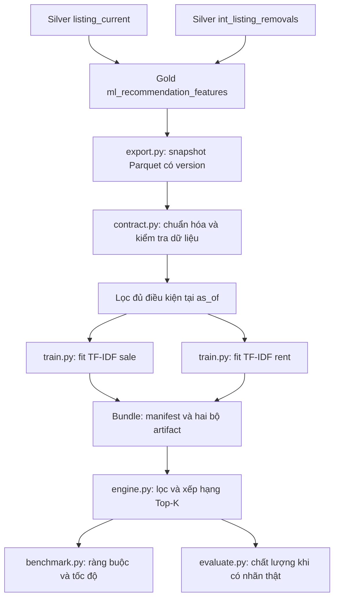

# Quy trình huấn luyện, vai trò mã Python và đánh giá mô hình gợi ý BĐS

Ngày lập tài liệu: **23/10/2026**.

Tài liệu mô tả đúng phiên bản đã triển khai trong repository, dựa trên mã nguồn
`recommendation/`, manifest mô hình và báo cáo benchmark đã lưu. Các số liệu là
kết quả của lần huấn luyện/benchmark `20261023_v1`; việc viết tài liệu này không
chạy lại huấn luyện hay thay đổi dữ liệu MinIO.

Tài liệu kiến trúc Silver → Gold liên quan:
[RECOMMENDATION_GOLD_MODEL.md](RECOMMENDATION_GOLD_MODEL.md).

## 1. Mô hình giải quyết bài toán nào?

Hệ thống có hai chức năng:

- **`similar()` — tin tương tự:** nhận mã một tin, trả Top-K tin khác cùng thị
  trường, loại BĐS, tỉnh và kỳ giá; ưu tiên nội dung và thuộc tính gần với tin gốc.
- **`preferences()` — theo nhu cầu:** nhận giao dịch, loại BĐS, khu vực, ngân
  sách, diện tích, số phòng và từ khóa; lọc điều kiện bắt buộc rồi xếp hạng.

Mô hình hiện tại là **content-based recommendation**, kết hợp **TF-IDF ký tự,
cosine similarity và điểm thuộc tính có trọng số**. Chưa có dữ liệu tương tác
người dùng để huấn luyện cá nhân hóa theo click/save/contact.

`sale` và `rent` có **hai bộ từ vựng, hai tập IDF và hai chỉ mục riêng**. Cùng
một thuật toán nhưng dữ liệu fit độc lập. Mô hình không gợi ý chéo giữa mua và
thuê; tiền thuê theo tháng không được so trực tiếp với tổng giá bán.

### “Huấn luyện” ở đây thực sự học gì?

| Thành phần | Cách hình thành |
|---|---|
| Từ vựng n-gram | Học từ nội dung các tin của từng thị trường |
| Trọng số IDF | Tính từ số tin chứa từng n-gram trong thị trường đó |
| Vector mỗi tin | Biến đổi nội dung bằng TF-IDF đã fit |
| Trọng số giá/nội dung/vị trí… | Đặt thủ công trong `DEFAULT_WEIGHTS`, ghi vào manifest |
| Quy tắc lọc sale/rent, ngân sách, thời hạn | Quy tắc nghiệp vụ trong Gold và engine |

Đây là bước **fit mô hình biểu diễn văn bản không có nhãn `y`**. Không có epoch,
backpropagation, loss học sâu hoặc nhãn giá cần dự đoán. `price_vnd` được dùng
để lọc và tính độ gần nhau, không phải mục tiêu hồi quy của mô hình này.

## 2. Quy trình huấn luyện từ đầu đến cuối



### Bước 1 — Chuẩn bị đặc trưng trong Gold

Nguồn chính là `silver.listing_current`. Gold join thêm
`silver.int_listing_removals` để nhận bằng chứng tin đã bị gỡ. Bảng kết quả:

```text
gold.ml_recommendation_features
s3://lakehouse/warehouse/gold.db/ml_recommendation_features
```

Gold lưu Delta, partition theo `transaction_type`, một dòng trên một tin
`listing_key`. Mã tạo bảng nằm ở
[`ml_recommendation_features.sql`](../dbt/models/gold/ml/ml_recommendation_features.sql).

Gold chuẩn hóa loại BĐS, xác định kỳ giá, ghép nội dung, đánh dấu độ tin cậy vị
trí, tạo nhóm trùng nội dung và cờ `is_recommendable`. Tin không đủ điều kiện
vẫn được giữ trong Gold để kiểm tra nhưng không được đưa vào model phục vụ.

| Nhóm đặc trưng | Ví dụ | Vai trò |
|---|---|---|
| Phân đoạn | `transaction_type`, `property_category`, `price_period` | Lọc đúng thị trường/loại/kỳ giá |
| Nội dung | `content_text` từ tiêu đề, mô tả, dự án và thuộc tính | Đầu vào TF-IDF |
| Giá và diện tích | `price_vnd`, `area_m2` | Bộ lọc và tương đồng số |
| Vị trí | ID tỉnh/huyện/xã, tọa độ, `location_trusted` | Lọc và tính độ gần |
| Cấu trúc | Phòng ngủ/tắm, subtype, pháp lý, nội thất | Điểm cấu trúc |
| Trạng thái/thời gian | `is_recommendable`, `last_seen_at` | Kiểm soát tin được phục vụ |
| Nhận dạng/trùng tin | `listing_key`, `duplicate_group` | Truy vết và hạn chế lặp |

Không phải mọi cột Gold đều đang tham gia điểm số. Chẳng hạn các cột log đã
tính sẵn, giá/m², chiều ngang/dài và số tầng được giữ để phân tích/mở rộng;
engine V1 tính độ gần giá/diện tích trực tiếp từ giá trị gốc.

### Bước 2 — Export đúng snapshot Delta

`export.py` đọc một phiên bản Delta, replay các hành động thêm/xóa file và đọc
những file còn hiệu lực. Không đọc tất cả Parquet trong thư mục vì có thể lẫn
file cũ sau MERGE. Cột partition `transaction_type` được khôi phục nếu không
nằm trong nội dung file Parquet.

Kết quả lần này:

- Phiên bản Gold: **Delta v0**; **18 file đang hiệu lực**, **155.623 dòng**.
- Export: `artifacts/recommendation/exports/20261023_v1/catalog.parquet`.
- Metadata: `snapshot.json` cùng thư mục, chứa table ID, Delta version,
  thời điểm export, số dòng và SHA-256 của Parquet.
- `train.py` đọc Parquet local; không truy vấn MinIO cho từng bước fit.

### Bước 3 — Kiểm tra và chuẩn hóa dữ liệu

`contract.prepare()` thực hiện:

1. Kiểm tra cột bắt buộc, ID rỗng/trùng, enum giao dịch/loại BĐS/kỳ giá.
2. Kiểm tra `sale` dùng `total`, `rent` không dùng `total`.
3. Chuẩn hóa kiểu số; giá trị không hữu hạn được chuyển thành thiếu dữ liệu.
4. Chuẩn hóa ID hành chính và chuyển thời gian về UTC.
5. Chuẩn hóa nội dung: Unicode, chữ thường, bỏ dấu tiếng Việt kể cả `đ`,
   gộp khoảng trắng và giới hạn 4.000 ký tự. Nội dung rỗng dùng chuỗi dự phòng.

Query và nội dung tin sử dụng cùng hàm chuẩn hóa. Nhờ đó truy vấn có dấu và
không dấu được xử lý nhất quán.

### Bước 4 — Chọn dữ liệu đủ điều kiện tại thời điểm cố định

Lần huấn luyện này sử dụng:

```text
as_of = 2026-10-23T04:55:03Z
      = 11:55:03 ngày 23/10/2026, giờ Việt Nam
max_age_days = 90
```

`eligible()` chỉ chọn tin có `is_recommendable=true`, giá/diện tích dương và
`last_seen_at` nằm trong khoảng `[as_of − 90 ngày, as_of]`. Không nhận ngày ở
tương lai. Trạng thái gỡ tin đã được đưa vào cờ Gold; `last_seen_at` tự nó không
chứng minh tin vẫn còn hoạt động.

| Tập dữ liệu | Số dòng |
|---|---:|
| Gold đầu vào | 155.623 |
| Đủ điều kiện đưa vào model | 64.612 |
| Không được chọn vào model tại thời điểm này | 91.011 |
| Model sale | 24.488 |
| Model rent | 40.124 |

91.011 là tổng số dòng bị loại bởi bộ điều kiện, không đồng nghĩa tất cả đều
“đã bán/đã thuê”. Trainer yêu cầu có dữ liệu hợp lệ cho cả sale và rent.

### Bước 5 — Fit TF-IDF riêng từng thị trường

Trainer xử lý **sale rồi rent**, giải phóng các đối tượng tạm giữa hai lần fit.
Trong mỗi thị trường, catalog được sắp theo `listing_key` trước khi vector hóa
để thứ tự hàng của metadata và ma trận luôn tương ứng.

| Tham số | Giá trị | Ý nghĩa |
|---|---|---|
| `analyzer` | `char_wb` | N-gram ký tự trong biên từ, có đệm khoảng trắng |
| `ngram_range` | `(3, 5)` | Đặc trưng dài 3, 4 hoặc 5 ký tự |
| `max_features` | `30000` | Tối đa 30.000 đặc trưng mỗi thị trường |
| `min_df` | `2` | Bỏ n-gram chỉ xuất hiện trong một tin; có điều chỉnh cho fixture rất nhỏ |
| `sublinear_tf` | `True` | Giảm ảnh hưởng của số lần lặp bằng biến đổi log |
| `norm` | `l2` | Chuẩn hóa vector để tính cosine bằng tích vô hướng |
| `dtype` | `float32` | Giảm bộ nhớ cho ma trận sparse |

Mỗi thị trường có một lần `fit_transform()`. Từ vựng và IDF của rent không
được học từ các tin sale. Ma trận không phải bảng N×N chứa mọi cặp tin:

- Sale: **24.488 × 30.000**, lưu sparse.
- Rent: **40.124 × 30.000**, lưu sparse.

Không dùng train/test ngẫu nhiên 80/20 trên tin để tuyên bố độ chính xác.
Phiên bản serving này fit toàn bộ catalog hợp lệ đang có. Việc chọn tham số
và đánh giá chất lượng cần chia riêng **tập truy vấn có nhãn** như mục 7.

### Bước 6 — Lưu bundle hoàn chỉnh

```text
artifacts/recommendation/models/20261023_v1/
├── manifest.json
├── sale/
│   ├── catalog.parquet
│   ├── matrix.npz
│   └── vectorizer.joblib
└── rent/
    ├── catalog.parquet
    ├── matrix.npz
    └── vectorizer.joblib
```

| Artifact | Nội dung và tác dụng |
|---|---|
| `catalog.parquet` | Metadata và đặc trưng các tin, theo đúng thứ tự hàng của ma trận |
| `matrix.npz` | Vector sparse TF-IDF của các tin đã fit |
| `vectorizer.joblib` | Từ vựng, IDF và cấu hình để biến đổi query mới |
| `manifest.json` | Version, thời điểm, tham số, trọng số, số dòng/chiều, phiên bản môi trường, checksum và hash thứ tự ID |

Trainer ghi vào thư mục staging rồi rename sau khi cả hai thị trường thành
công. Thư mục version đã tồn tại sẽ bị từ chối ghi đè. Khi load, engine kiểm
tra checksum, thứ tự ID, kích thước ma trận/từ vựng và phiên bản sklearn.

Môi trường ghi nhận: **Python 3.12.9, scikit-learn 1.6.1**.
Manifest ghi `quality_status = not_evaluated_with_human_labels`.

## 3. Tác dụng của từng file `.py`

Các đường dẫn dưới đây tính từ thư mục gốc repository.

| File | Hàm/lớp chính | Nhiệm vụ và đầu vào → đầu ra |
|---|---|---|
| [`recommendation/__init__.py`](../recommendation/__init__.py) | Khởi tạo package | Đánh dấu module Python; chỉ có mô tả package, không chạy train hoặc load model |
| [`recommendation/contract.py`](../recommendation/contract.py) | `prepare`, `eligible`, `normalize_text`, `utc`, `file_hash`, `key_hash` | Quy ước dữ liệu dùng chung: DataFrame thô → DataFrame chuẩn hóa; tạo mask hợp lệ và checksum. Khai báo enum, schema version, trọng số khởi đầu |
| [`recommendation/export.py`](../recommendation/export.py) | `filesystem`, `read_snapshot`, `export` | Credentials/endpoint và Delta version → snapshot Parquet + metadata. Chỉ đọc MinIO, tạo bản export local bất biến |
| [`recommendation/train.py`](../recommendation/train.py) | `train`, `main` | Snapshot Parquet + tham số/as-of → bundle sale/rent. Lọc dữ liệu, fit TF-IDF, lưu artifact và manifest |
| [`recommendation/engine.py`](../recommendation/engine.py) | `RecommendationEngine`, `similar`, `preferences` | Bundle + request → danh sách Top-K có điểm và thành phần giải thích. Kiểm tra artifact, lọc, chấm điểm và loại nhóm trùng |
| [`recommendation/__main__.py`](../recommendation/__main__.py) | `main` | Điểm vào `python -m recommendation`; đọc tham số CLI, gọi engine và in JSON. Không huấn luyện lại |
| [`recommendation/benchmark.py`](../recommendation/benchmark.py) | `benchmark` | Bundle → kiểm tra ràng buộc, số kết quả, latency, RAM và ví dụ. Không cần nhãn và không tính độ chính xác gợi ý |
| [`recommendation/evaluate.py`](../recommendation/evaluate.py) | `evaluate` | Bundle + nhãn JSONL thật → Precision@K, pooled Recall@K, nDCG@K, tách theo sale/rent và tune/test |
| [`recommendation/tests/test_recommendation.py`](../recommendation/tests/test_recommendation.py) | `fixture`, `RecommendationTests` | Tạo dữ liệu giả có kiểm soát trong thư mục tạm, kiểm tra hành vi đúng/sai mong đợi. Không dùng fixture làm bằng chứng chất lượng trên người dùng thật |

### Các hàm quan trọng trong `engine.py`

| Hàm | Tác dụng |
|---|---|
| `__init__()` | Load manifest và hai bộ artifact; kiểm tra tính nhất quán; tạo lookup từ ID sang thị trường/hàng |
| `_candidates()` | Lọc eligibility, giao dịch, loại, kỳ giá, địa phương và điều kiện số |
| `numeric_similarity()` | Chấm mức gần nhau của giá/diện tích bằng tỷ lệ trên thang log |
| `location_similarity()` | Chấm khoảng cách Haversine khi đáng tin; fallback theo phân cấp ID tỉnh/huyện/xã |
| `_rank()` | Thêm điểm độ mới, tổng hợp trọng số, sort ổn định và giữ tối đa một tin mỗi nhóm trùng |
| `similar()` | Chọn chỉ mục theo seed, bắt buộc cùng tỉnh/loại/kỳ giá, loại seed và nhóm trùng của seed |
| `preferences()` | Lọc theo nhu cầu, biến đổi query bằng vectorizer đã fit, chấm giá/diện tích mục tiêu nếu có |

Thứ tự sử dụng chính:

```text
export.py → train.py → engine.py qua __main__.py
                         ├─ benchmark.py
                         └─ evaluate.py khi có nhãn

contract.py được dùng chung giữa các bước.
tests/test_recommendation.py kiểm tra độc lập bằng fixture nhỏ.
```

## 4. Mô hình xếp hạng kết quả như thế nào?

Sau khi qua bộ lọc, `similar()` kết hợp các điểm:

| Thành phần | Trọng số khởi đầu | Cách tính |
|---|---:|---|
| Nội dung | 0,35 | Cosine của vector TF-IDF |
| Giá | 0,25 | `exp(-abs(log(candidate / target)) / 0.35)` |
| Diện tích | 0,15 | Công thức tương tự với độ rộng `0.30` |
| Vị trí | 0,15 | `exp(-distance_km / 12)` hoặc fallback hành chính |
| Cấu trúc | 0,05 | Trung bình độ gần số phòng và mức khớp subtype/pháp lý/nội thất có thông tin ở seed |
| Độ mới | 0,05 | `exp(-age_days / 60)` |

Điểm tổng = tổng các điểm thành phần nhân trọng số, chia tổng trọng số của
các thành phần được sử dụng. Khi kỳ giá không xác định, bỏ thành phần giá;
khi seed không có dữ liệu cấu trúc, bỏ thành phần cấu trúc.

Trọng số đang giống nhau giữa sale và rent nhưng được lưu riêng trong
manifest. Chưa có quá trình học/tối ưu chúng bằng nhãn người đánh giá.

Trong `preferences()`:

- `max_price` là trần ngân sách bắt buộc; `target_price` là giá mong muốn để
  xếp hạng. Tương tự, `min_area` khác `target_area`.
- Rent phải chỉ rõ kỳ giá; ngân sách không được áp dụng cho kỳ `unknown`.
- Khi có query, chỉ giữ ứng viên có cosine dương; query ngoài từ vựng trả rỗng.
- Nếu chỉ nhập bộ lọc và không nhập tiêu chí xếp hạng, kết quả ưu tiên độ mới.
- Có thể trả ít hơn K, không tự nới điều kiện để lấp đủ danh sách.

Điểm như `0.72` là điểm xếp hạng tổng hợp, **không phải xác suất thích tin 72%**.

## 5. Kết quả huấn luyện đã ghi nhận

Nguồn: [manifest mô hình](../artifacts/recommendation/models/20261023_v1/manifest.json)
và [metadata export](../artifacts/recommendation/exports/20261023_v1/snapshot.json).

| Chỉ số | Sale | Rent |
|---|---:|---:|
| Số tin | 24.488 | 40.124 |
| Số chiều TF-IDF thực tế | 30.000 | 30.000 |
| Thời gian trong vòng fit/lưu phân đoạn | 20,105 giây | 30,760 giây |

Tổng hai khoảng thời gian là **50,865 giây**. Đây không phải toàn bộ thời gian
pipeline: nó không bao gồm build Gold, export, đọc/chuẩn hóa đầu vào chung và
benchmark. Bundle hai thị trường khoảng 203,6 MB; snapshot export khoảng
147,1 MB, theo lần kiểm tra kích thước khi triển khai.

## 6. Đánh giá hiện tại: điều gì đã được chứng minh?

### 6.1. Kiểm tra tính đúng đắn

Trong lần triển khai đã ghi nhận **12 dbt tests** và **12 unittest Python** pass.
Các test Python bao gồm:

- Không trộn sale/rent, tỉnh và loại BĐS trong tin tương tự.
- Không trả lại seed hoặc nhiều tin cùng nhóm trùng.
- Loại tin được đánh dấu không đủ điều kiện; kiểm tra ngày tương lai và tuổi tin.
- Bắt buộc kỳ giá thuê, không so ngân sách với kỳ giá không xác định.
- Tuân thủ ngân sách, diện tích và số phòng tối thiểu.
- Query có dấu/không dấu nhất quán và query không khớp trả rỗng.
- Không khớp huyện chỉ vì cùng ID huyện nhưng khác tỉnh.
- Phát hiện file catalog bị sửa và thứ tự catalog/index bị đảo.
- Từ chối ID trùng và ghi đè bundle hiện có.
- Evaluation dùng thời điểm cố định, xử lý `max_age_days` một lần, kiểm tra K/version.
- Export Delta xử lý file đã bị remove và khôi phục cột partition.

Các kiểm tra này chứng minh những hành vi cụ thể trên fixture, không chứng
minh tất cả tình huống thực tế đều đúng hoặc người dùng thích các gợi ý.

### 6.2. Benchmark trên dữ liệu thật

Nguồn: [báo cáo benchmark](../artifacts/recommendation/reports/20261023_v1.json).

Cách tạo phép đo trong `benchmark.py`:

1. Load bundle đã train đầy đủ và cố định `as_of` theo manifest.
2. Mỗi thị trường chọn 50 seed có tỉnh, `random_state=42`.
3. Chạy `similar()` với K=10.
4. Từ seed tạo preferences: cùng loại/tỉnh/kỳ giá, trần giá bằng 110% giá seed,
   diện tích tối thiểu bằng 90% diện tích seed, tối thiểu một phòng ngủ.
5. Chạy tuần tự, đo thời gian từng lời gọi engine. **Preferences benchmark
   không có query văn bản** và không phải tập nhu cầu do người dùng thật nhập.

| Chỉ số | Sale | Rent |
|---|---:|---:|
| Truy vấn similar | 50 | 50 |
| Kết quả similar | 500 | 500 |
| Truy vấn similar thiếu 10 kết quả | 0 | 0 |
| Vi phạm ràng buộc similar được kiểm tra | 0 | 0 |
| p95 similar | 406,37 ms | 295,24 ms |
| Truy vấn preferences | 50 | 50 |
| Kết quả preferences | 390 | 250 |
| Vi phạm bộ lọc preferences được kiểm tra | 0 | 0 |
| p95 preferences | 16,00 ms | 16,60 ms |

Load hai model mất **10,458 giây**; RAM đỉnh của tiến trình benchmark khoảng
**1.101,6 MB**; tổng benchmark **32,2 giây**. RAM này không phải RAM của cả
Docker stack hoặc RAM đỉnh khi train.

p95 là phân vị 95 của thời gian quan sát trong phép đo. Nó không bao gồm
HTTP/network và không dự báo chính xác độ trễ khi nhiều người gọi đồng thời.
Không nên kết luận thuật toán rent luôn nhanh hơn sale chỉ từ 50 truy vấn:
kích thước nhóm ứng viên của từng loại BĐS cũng ảnh hưởng thời gian.

390 và 250 kết quả preferences không có nghĩa những kết quả còn thiếu là lỗi.
Các điều kiện có thể làm số ứng viên nhỏ hơn K; một số loại như đất không phù
hợp bộ lọc tối thiểu một phòng ngủ. Báo cáo chưa thống kê riêng số truy vấn
preferences trả rỗng nên không suy diễn tỷ lệ trả rỗng từ tổng số kết quả.

### 6.3. Đánh giá về mức độ phù hợp

**Chưa có nhãn người đánh giá, nên chưa có Precision@10, Recall@10 hoặc
nDCG@10 thực nghiệm đáng tin cậy cho mức độ phù hợp.**

Không có vi phạm bộ lọc không đồng nghĩa “độ chính xác 100%”. Tin cùng loại,
đúng ngân sách vẫn có thể không hợp người dùng về tiện ích, môi trường sống
hoặc vị trí cụ thể.

Ví dụ trong báo cáo rent: kết quả ở Quận Tân Bình và Quận 7 có thể cùng xuất
hiện trong một danh sách similar, vì ràng buộc địa lý cứng của similar là
cùng tỉnh; huyện/quận tác động qua điểm địa lý. Khi người dùng yêu cầu một
quận cụ thể, cần dùng `district_id` trong preferences.

## 7. Đánh giá chất lượng bằng `evaluate.py` như thế nào?

### 7.1. Chuẩn bị tập nhãn

Kế hoạch đề xuất:

- Khoảng 240 truy vấn: 120 sale, 120 rent; mỗi thị trường gồm similar và preferences.
- Phủ các loại BĐS, khu vực và phân khúc giá; có trường hợp ít/rỗng ứng viên.
- Chia tune/test theo nhóm seed/BĐS để hạn chế cùng một BĐS xuất hiện ở cả hai tập.
- Pool ứng viên từ nhiều baseline rồi chấm 0–3: 0 không phù hợp, 1 hơi phù hợp,
  2 phù hợp, 3 rất phù hợp. Khi thêm mô hình mới, chấm bổ sung kết quả chưa có nhãn.
- Pin dataset version và `as_of`. Không lấy catalog hiện tại để mô phỏng trạng
  thái quá khứ nếu không có snapshot tương ứng.

Ví dụ cấu trúc một dòng JSONL; các ID sau là placeholder, **không phải nhãn thật**:

```json
{"dataset_version":"gold.ml_recommendation_features.delta_v0","split":"test","as_of":"2026-10-23T04:55:03Z","method":"preferences","request":{"transaction_type":"rent","property_category":"HOUSE","price_period":"month","max_price":15000000,"max_age_days":90},"relevance":{"REAL_KEY_A":3,"REAL_KEY_B":0}}
```

Evaluator kiểm tra version, grade, ID, các positive có thuộc tập đủ điều kiện
hay không và mọi kết quả Top-K đã được chấm chưa. `limit` được gán bằng K,
`as_of` lấy từ annotation; request dùng cùng engine và bộ lọc như serving.

### 7.2. Các chỉ số và cách diễn giải

| Chỉ số | Cách tính / ý nghĩa |
|---|---|
| Precision@K | Số kết quả có grade > 0 chia K. Nếu trả ít hơn K, vẫn chia K |
| Pooled Recall@K | Số positive truy hồi được chia số positive trong pool đã chấm |
| nDCG@K | Dùng gain `2^grade − 1`, giảm theo `log2(rank + 1)`, chuẩn hóa với thứ tự tốt nhất trong pool |

Đầu ra được tổng hợp riêng thành `sale/tune`, `sale/test`, `rent/tune`,
`rent/test`. Mỗi truy vấn có trọng số như nhau khi lấy trung bình.

Nếu một truy vấn không có positive trong pool, Precision vẫn được tính;
pooled Recall và nDCG của truy vấn đó là không xác định và không được gộp vào
trung bình hai metric này. Báo cáo có số truy vấn được dùng cho từng metric.

Pooled Recall không phải Recall trên mọi tin trong MinIO. Chất lượng nhãn,
độ đầy đủ của pool và cách chia tune/test đều ảnh hưởng kết luận.

### 7.3. Cách chọn phiên bản tốt hơn

So sánh rule-based và TF-IDF hiện tại trên cùng bộ nhãn. Chỉnh trọng số,
ngram, `min_df` và các ngưỡng trên tập tune; giữ tập test để đánh giá sau cùng.
Lựa chọn riêng cho sale/rent nếu có bằng chứng. Phiên bản hiện tại chưa có
chức năng tự tìm siêu tham số hoặc tự chọn champion.

Embedding đa ngôn ngữ hay learning-to-rank là hướng thử nghiệm sau; chưa được
triển khai và chưa có kết quả chứng minh tốt hơn bản hiện tại trên dữ liệu này.

## 8. Lệnh chạy và tái lập

Chạy từ thư mục gốc `LakeHouse-Architecture-For-RealEstateData`. Thư viện mô tả
trong `recommendation/requirements.txt`; load bundle hiện tại cần sklearn
đúng phiên bản **1.6.1** như manifest.

### Kiểm tra hoặc sử dụng bundle đã có

```bash
python3 -m unittest discover -s recommendation/tests -v

python3 -m recommendation \
  --bundle artifacts/recommendation/models/20261023_v1 \
  preferences --request '{"transaction_type":"rent","property_category":"HOUSE","price_period":"month","max_price":15000000,"min_bedrooms":2,"query":"gần trường học","as_of":"2026-10-23T04:55:03Z","limit":10}'

python3 -m recommendation.benchmark \
  --bundle artifacts/recommendation/models/20261023_v1 \
  --queries 50 \
  --output artifacts/recommendation/reports/benchmark_rerun.json
```

### Huấn luyện lại từ snapshot đã có

`RETRAIN_VERSION` là tên thư mục mới chưa tồn tại; không dùng lại `20261023_v1`.

```bash
OPENBLAS_NUM_THREADS=1 OMP_NUM_THREADS=1 MKL_NUM_THREADS=1 \
python3 -m recommendation.train \
  --input artifacts/recommendation/exports/20261023_v1/catalog.parquet \
  --output artifacts/recommendation/models/RETRAIN_VERSION \
  --dataset-version gold.ml_recommendation_features.delta_v0 \
  --as-of 2026-10-23T04:55:03Z \
  --max-age-days 90 --max-features 30000 --min-df 2
```

Để cập nhật dữ liệu, build/test Gold, export version mới, rồi train version
model mới. Hướng dẫn build/export có trong tài liệu kiến trúc liên kết ở đầu.
Benchmark của bản khác cần lưu ra file riêng để không mất kết quả đối chứng.

### Đánh giá khi đã có nhãn thật

```bash
python3 -m recommendation.evaluate \
  --bundle artifacts/recommendation/models/20261023_v1 \
  --labels real_labels.jsonl --k 10 \
  --output evaluation_real_labels.json
```

## 9. Nhận xét mô hình và giới hạn còn lại

**Đã có nền tảng baseline hoạt động và kiểm tra được:** fit toàn bộ catalog đủ
điều kiện, tách sale/rent và kỳ giá, giải thích điểm, kiểm tra artifact, phục vụ
qua Python/CLI và có công cụ đánh giá với nhãn.

Các giới hạn cần giữ rõ khi báo cáo hoặc triển khai:

1. TF-IDF phản ánh giống nhau về chuỗi ký tự; chưa hiểu đầy đủ ngữ nghĩa,
   phủ định hoặc các yêu cầu tiện ích phức tạp.
2. Trọng số xếp hạng đang là giả thuyết kỹ thuật; chưa được xác nhận bằng nhãn.
3. `duplicate_group` chỉ là heuristic trùng nội dung, có thể bỏ sót hoặc gộp
   nhầm; chưa có entity resolution hoàn chỉnh cho cùng BĐS vật lý.
4. Dữ liệu thiếu/sai vị trí làm giảm chất lượng so khớp; không thể khắc phục
   hoàn toàn chỉ bằng mô hình xếp hạng.
5. Bundle là snapshot: không biết một tin vừa bị gỡ sau lần export. Cần cập
   nhật theo nhịp crawl/Gold, kiểm tra rồi nạp bundle mới vào tiến trình phục vụ.
6. Chưa đo HTTP API, tải đồng thời, độ ổn định dài hạn hoặc mức độ hài lòng
   người dùng. Benchmark hiện tại là phép đo tuần tự trên máy đang dùng.
7. Chưa tự triển khai vào FastAPI, chưa đăng ký MLflow Registry và chưa có lịch
   tự động retrain recommendation. Gold đã nằm trong phạm vi dbt Gold hiện có.

**Kết luận đánh giá:** đủ làm baseline có thể tái lập và kiểm tra các ràng buộc
đã nêu. Bước tiếp theo để khẳng định “gợi ý tốt” là xây bộ nhãn thật, so sánh
baseline và chọn cấu hình dựa trên kết quả test riêng cho sale/rent.
