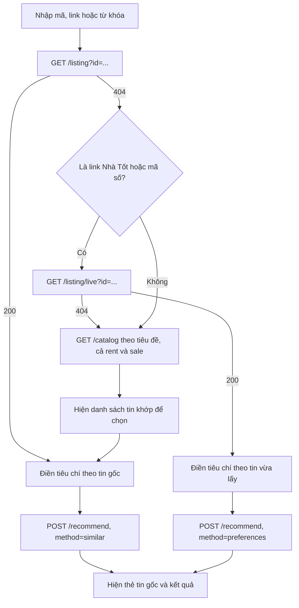

# Web demo: tra cứu theo mã tin và dự đoán giá

Tài liệu này mô tả phần vừa làm trên web demo (http://localhost:8501): nhập một mã tin để tự điền biểu mẫu, gợi ý tin tương tự, và dự đoán giá ngay trên cùng trang. Từ 05/11/2026, trang còn nhận link hoặc mã của tin Nhà Tốt **chưa có trong dữ liệu**: hệ thống lấy tin trực tiếp từ Nhà Tốt rồi tự điền như tin có sẵn (mục 2.4). Kết nối giữa các service được giải thích trong [MLFLOW_VA_FASTAPI.md](MLFLOW_VA_FASTAPI.md).

## 1. Đã thay đổi những gì

Trước đây, người dùng phải tự chọn từng tiêu chí và không dự đoán giá được trên trang demo. Giờ trang có 3 tab:

| Tab | Chức năng |
|---|---|
| **Gợi ý** | Nhập mã tin, link hoặc từ khóa để tự điền tiêu chí và gợi ý tin |
| **Chấm nhãn** | Tạo phiếu từ kết quả gợi ý, chấm điểm, xuất JSONL/CSV, xem metric |
| **Dự đoán giá** | Dự đoán giá bán từ form nhập tay hoặc từ một mã tin bán |

| File | Thay đổi |
|---|---|
| `web/recommendation/index.html` | Viết lại giao diện: tab, ô tra cứu, thẻ tin gốc, tab dự đoán giá |
| `api/app/recommendation/main.py` | Thêm `GET /listing`, thêm trường dữ liệu trả về, thêm proxy `/price/*` |
| `api/tests/test_recommendation.py` | Thêm test tra cứu theo khóa, mã nguồn và link |
| `recommendation/tests/test_recommendation.py` | Thêm `source_listing_id` vào dữ liệu test |
| `web/README.md` | Cập nhật mô tả |
| `api/app/recommendation/live.py` (05/11) | Mới: lấy một tin từ Nhà Tốt và bóc tách như dbt staging |
| `api/app/recommendation/main.py` (05/11) | Thêm `GET /listing/live` |
| `web/recommendation/index.html` (05/11) | Không tìm thấy tin thì thử `/listing/live` |
| `api/tests/test_recommendation.py` (05/11) | Thêm test cho `/listing/live`, giả lập phản hồi của Nhà Tốt |

Trang web vẫn là một file HTML và JavaScript thuần, do FastAPI phục vụ, không cần bước build.

## 2. Backend

### 2.1 `GET /listing?id=<giá trị>`

Endpoint này tìm một tin từ thứ người dùng dán vào. Hàm `resolve` thử theo thứ tự:

1. Bỏ khoảng trắng hai đầu, rồi so khớp nguyên văn với `listing_key`.
2. Nếu không khớp, lấy dãy số ở cuối chuỗi rồi so với `source_listing_id` của cả hai thị trường.
3. Nếu vẫn không có, trả 404.

Bước 2 dùng biểu thức `(\d+)(?:\.htm)?/?(?:[?#].*)?$`, nên các dạng sau đều tìm ra cùng một tin:

| Người dùng nhập | Mã được lấy |
|---|---|
| `135220851` | `135220851` |
| `https://www.nhatot.com/135220851.htm` | `135220851` |
| `https://www.nhatot.com/135220851.htm?src=share` | `135220851` |
| `https://gateway.chotot.com/v1/public/ad-listing/135220851` | `135220851` |

Thiếu tham số `id` thì trả 422.

### 2.2 Thêm trường dữ liệu

Hàm `details` trả về nhiều trường hơn, áp dụng cho `/listing`, `/catalog`, `/recommend` và phiếu chấm nhãn:

| Nhóm | Trường mới | Dùng cho |
|---|---|---|
| Hiển thị thẻ tin | `source_listing_id`, `bathrooms`, `ward`, `property_subtype`, `project_name`, `legal_status`, `furnishing`, `house_direction`, `has_car_alley`, `is_frontage` | Thẻ tin gốc và thẻ kết quả |
| Form dự đoán giá | `property_type`, `ward_id`, `living_area_m2`, `width_m`, `length_m`, `total_floors`, `floor_number`, `handover_status`, `is_planning_affected` | Tự điền form giá |

Các trường này đọc từ bundle của model gợi ý. Giá trị thiếu được trả về là `null`.

### 2.3 Proxy sang API giá

| Endpoint trên cổng 8501 | Chuyển tới `fastapi:8000` |
|---|---|
| `GET /price/model` | `GET /model` |
| `GET /price/options` | `GET /options` |
| `POST /price/predict` | `POST /predict` |

Proxy không tự kiểm tra dữ liệu, API giá đã làm việc đó bằng `PropertyInput`. Timeout là 30 giây. Lý do cần proxy được giải thích ở [mục 7.3 của tài liệu MLflow và FastAPI](MLFLOW_VA_FASTAPI.md#73-vì-sao-có-price).

### 2.4 `GET /listing/live?id=<giá trị>`

Dùng khi tin không có trong dữ liệu của model, ví dụ tin vừa đăng sau lần crawl gần nhất.

1. Lấy mã tin từ chuỗi người dùng nhập. Chỉ chấp nhận mã số (từ 6 chữ số) hoặc link thuộc `nhatot.com` hay `chotot.com`. Chuỗi khác trả 422.
2. Gọi `https://gateway.chotot.com/v1/public/ad-listing/<mã>`, cùng địa chỉ mà crawler `scripts/crawl_nhatot_profiles.py` dùng. Timeout 15 giây.
3. Bóc tách JSON trả về **theo đúng quy tắc của pipeline**, để dữ liệu đưa vào model khớp với lúc train:

| Trường | Quy tắc lấy từ |
|---|---|
| Loại giao dịch, giá, diện tích, phòng, tầng, vị trí, pháp lý, nội thất, hướng, các cờ hẻm xe hơi / mặt tiền / nở hậu… | `dbt/models/staging/nhatot/stg_nhatot_properties.sql` |
| `property_category`, `property_subtype` khi thiếu | `dbt/models/gold/dimensions/dim_property_type.sql` |
| `price_period` của tin thuê | `dbt/models/gold/ml/ml_recommendation_features.sql` |

Kết quả có cùng các trường với `GET /listing`, thêm `live: true`.

| Trường hợp | Mã trả về |
|---|---|
| Lấy được tin | 200 |
| Không phải link Nhà Tốt/Chợ Tốt hay mã số | 422 |
| Nhà Tốt không có tin (sai mã hoặc tin đã gỡ) | 404 |
| Không kết nối được Nhà Tốt hoặc Nhà Tốt trả lỗi | 502 |

**Tin lấy về không được ghi vào lakehouse.** Ghi một tin lẻ thành một lần crawl riêng sẽ làm sai logic đánh dấu lần crawl đầy đủ và tin đã gỡ (`int_crawl_snapshots`, `int_listing_removals`). Tin sẽ vào dữ liệu theo đường bình thường ở lần crawl hằng ngày sau đó.

## 3. Tab Gợi ý

### 3.1 Luồng tra cứu



### 3.2 Tự điền tiêu chí

| Ô trên form | Lấy từ tin gốc |
|---|---|
| Giao dịch | `transaction_type` |
| Loại bất động sản | `property_category` |
| Chu kỳ giá | `price_period` |
| Tỉnh/thành, Quận/huyện | `province_id`, `district_id` |
| Giá mong muốn | `price_vnd`, để trống nếu chu kỳ giá là `unknown` |
| Diện tích mong muốn | `area_m2` |
| Phòng ngủ tối thiểu | `bedrooms` |
| Từ khóa nhu cầu | `title` |
| Ngân sách tối đa, Diện tích tối thiểu | Luôn xóa trống, vì một tin đăng không có các giá trị này |

Tin có vị trí không đáng tin cậy sẽ không nằm trong bộ lọc quận, nên ô Quận/huyện để trống.

### 3.3 Khi nào dùng `similar`, khi nào dùng `preferences`

| Trạng thái form | Phương thức | Ý nghĩa |
|---|---|---|
| Có tin gốc, chưa sửa ô nào | `similar` | So sánh trực tiếp với tin gốc |
| Có tin gốc, đã sửa ít nhất một ô | `preferences` | Xếp hạng theo các tiêu chí đang hiển thị |
| Không có tin gốc | `preferences` | Xếp hạng theo tiêu chí nhập tay |
| Tin gốc lấy từ `/listing/live` | `preferences` | Tin chưa nằm trong index của model nên không so trực tiếp được. Trang gợi ý theo tiêu chí tự điền từ tin, tiêu đề kết quả là "Các tin gần với tin vừa lấy" |

Hộp trạng thái phía trên form cho biết đang ở chế độ nào, kèm nút **Khôi phục theo tin gốc** và **Bỏ tin gốc**. Đổi riêng ô **Số kết quả** không làm mất chế độ `similar`.

### 3.4 Thẻ kết quả

Mỗi kết quả có:

- Điểm xếp hạng và phần **Vì sao gợi ý tin này?** với 6 thành phần: nội dung, giá, diện tích, vị trí, cấu trúc, độ mới.
- Chênh lệch so với tin gốc: giá, diện tích, cùng quận. Chỉ hiện khi hai tin cùng loại giao dịch và cùng chu kỳ giá.
- Nút **Tìm tin tương tự tin này** để lấy kết quả đó làm tin gốc mới.
- Link **Mở tin gốc**. URL trong dữ liệu trỏ tới API JSON của Chợ Tốt, nên trang đổi sang địa chỉ `www.nhatot.com/<mã>.htm` cho dễ đọc.

## 4. Tab Dự đoán giá

### 4.1 Luồng

1. Khi mở trang, tab gọi `/price/options` và `/price/model` để tạo các danh sách chọn và hiện version kèm MAPE.
2. Người dùng nhập tay, hoặc nhập mã/link tin bán rồi bấm **Điền và dự đoán**. Tin không có trong dữ liệu sẽ được lấy từ Nhà Tốt qua `/listing/live`.
3. Trang kiểm tra tin có phù hợp với model giá không, điền form, rồi gọi `/price/predict`.
4. Kết quả hiện giá dự đoán. Nếu form được điền từ tin gốc và chưa sửa, trang hiện thêm giá đăng và phần trăm chênh lệch.

Danh sách chọn lấy từ chính model đang chạy. Hiện tại có 3 loại bất động sản (`Căn hộ/Chung cư`, `Nhà ở`, `Đất`) và 22 quận/huyện.

### 4.2 Tin nào không dự đoán được

Hàm `priceBlocker` chặn và báo lý do trong các trường hợp:

| Trường hợp | Lý do |
|---|---|
| Tin cho thuê | Model chỉ học giá bán |
| `property_category = COMMERCIAL` | Văn phòng, mặt bằng đã bị loại khỏi dữ liệu train |
| `property_type` không có trong model | Model chưa từng học loại này |
| Quận/huyện không có trong model | Model chưa có dữ liệu ở quận đó |

### 4.3 Chuyển dữ liệu từ tin sang form

Tin đăng và model giá không dùng chung mọi giá trị, nên cần một số quy đổi:

- **Pháp lý:** `legal_status` của tin được đổi sang nhóm mà model hiểu, qua bảng `LEGAL_CATEGORY`. Ví dụ `Sổ hồng riêng` thành `Có sổ`, `Hợp đồng đặt cọc` thành `Giấy tờ khác`. Các giá trị khác thành `Không rõ`.
- **Giá trị lạ:** nếu giá trị không có trong danh sách chọn của model thì ô được đặt về `Không rõ`.
- **Kích thước phi lý bị bỏ:** `living_area_m2` quá 20.000, `width_m` quá 100 hoặc `length_m` quá 300 sẽ để trống, giống giới hạn của `ml_price_features`.
- **Tọa độ:** form không có bản đồ, nên trang dùng tọa độ trung vị của phường lấy từ `form_options.json`. Không chọn phường thì không gửi tọa độ.
- **Các ô tick:** luôn gửi `true` hoặc `false`, kể cả khi không tick.

Điểm cuối rất quan trọng. Dữ liệu train không có giá trị rỗng ở các cột này, và theo ghi chú trong code, gửi `null` làm giá dự đoán giảm khoảng 27%. Vì vậy **gọi thẳng `POST /predict` mà bỏ các cờ này sẽ ra số khác với web**.

### 4.4 Cách đọc kết quả

Khi trình bày cần nói rõ hai điều, trang web cũng có ghi chú tương tự:

- **Giá đăng không phải giá giao dịch.** Model học từ giá rao bán, nên nó ước lượng giá rao.
- **Độ lệch của một tin không phải sai số của model.** Tin đó có thể đã nằm trong dữ liệu train. Sai số phải đọc từ MAPE trên tập test: v11 hiện là 19,84%.
- **Ngoại lệ là tin lấy qua `/listing/live`.** Tin này chưa có trong dữ liệu train, nên độ lệch của nó là sai số thật của model trên một tin mới. Trang ghi chú khác cho trường hợp này. Thử nhiều tin mới đăng là một cách kiểm tra model ngoài tập test.

## 5. Mở trực tiếp bằng link

| Link | Kết quả |
|---|---|
| `http://localhost:8501/?id=135220851` | Tab Gợi ý, tra sẵn tin đó |
| `http://localhost:8501/?id=135220851#pricing` | Tab Dự đoán giá, tra sẵn tin đó |
| `#discover`, `#grading`, `#pricing` | Mở thẳng tab tương ứng |

Sau mỗi lần tra cứu, địa chỉ trên trình duyệt tự cập nhật, nên có thể sao chép để chia sẻ.

## 6. Kịch bản demo

Stack đã bật và hai model đã được nạp:

1. Mở http://localhost:8501. Góc trên hiện version model gợi ý.
2. Ở tab **Gợi ý**, nhập `135220851` rồi bấm **Điền và gợi ý**. Đây là tin bán căn hộ 58 m², giá đăng 2,3 tỷ. Form tự điền và kết quả hiện theo tin tương tự.
3. Mở **Vì sao gợi ý tin này?** ở một kết quả để giải thích điểm.
4. Sửa một tiêu chí và gợi ý lại, để cho thấy trang chuyển sang chế độ theo nhu cầu.
5. Khôi phục theo tin gốc, rồi bấm **Dự đoán giá tin này** trên thẻ tin gốc.
6. Tab **Dự đoán giá** tự điền form và hiện kết quả so với giá đăng.
7. Thử nhập một mã tin cho thuê để xem trang từ chối và nêu lý do.
8. Mở www.nhatot.com, chọn một tin bán ở TP.HCM vừa đăng, dán link vào tab **Dự đoán giá**. Thẻ tin ghi "Vừa lấy từ Nhà Tốt, chưa có trong dữ liệu", form tự điền và hiện giá dự đoán so với giá đăng.

Mã tin phụ thuộc dữ liệu của model đang chạy. Nếu mã trên không còn, dùng các nút **Thử mã mẫu** trên trang.

## 7. Kiểm thử

Chạy khi stack đang bật:

```bash
docker compose -p kltn exec -T recommendation-worker \
  python -m unittest recommendation.tests.test_recommendation api.tests.test_recommendation
```

Kết quả ngày 02/11/2026: **18 test, tất cả đạt**. Test `test_listing_lookup_by_key_source_id_or_link` bao phủ bốn dạng nhập hợp lệ, hai trường hợp không tìm thấy (404) và trường hợp thiếu tham số (422).

Trên dữ liệu thật, các lệnh `curl` sau cũng đã được chạy và trả đúng:

```bash
curl -s 'localhost:8501/listing?id=135220851'
curl -s 'localhost:8501/listing?id=no-such'      # 404
curl -s localhost:8501/price/model
```

Ngày 05/11/2026 thêm `test_live_listing_maps_nhatot_payload_like_staging`: giả lập phản hồi của Nhà Tốt rồi kiểm tra cách bóc tách (loại tin, chu kỳ giá, quận, phường, các cờ), trường hợp 404 và link không hợp lệ (422). Chạy `api.tests.test_recommendation` trong image `kltn-fastapi`: 7 test, tất cả đạt. Endpoint cũng đã được thử với một tin thật đang đăng trên Nhà Tốt.

Phần chưa có test tự động: toàn bộ JavaScript của trang, và các endpoint `/price/*`.

## 8. Giới hạn

- **Tin ngoài dữ liệu chỉ lấy được từ Nhà Tốt**, qua link hoặc mã số. Tra theo tiêu đề vẫn chỉ tìm trong bundle của model gợi ý (hiện có 21.193 tin bán và 32.408 tin thuê).
- **`/listing/live` phụ thuộc Nhà Tốt.** Nếu Nhà Tốt chặn hoặc đổi cấu trúc JSON, tính năng này lỗi. Khi đó vẫn nhập tay form được.
- **Tin lấy trực tiếp không dùng được chế độ `similar`**, vì không nằm trong index của model, nên chỉ gợi ý theo tiêu chí.
- **Tìm theo tiêu đề là so khớp chuỗi con**, không phải tìm kiếm ngữ nghĩa, và chỉ lấy một số dòng đầu tiên khớp.
- **Tab Dự đoán giá phụ thuộc hai service**, vì cần cả `recommendation-api` và `fastapi`.
- **Hai model có thể dùng dữ liệu của hai thời điểm khác nhau**, vì model gợi ý retrain sau mỗi lần Gold đạt test, còn model giá chỉ train vào thứ Hai.
